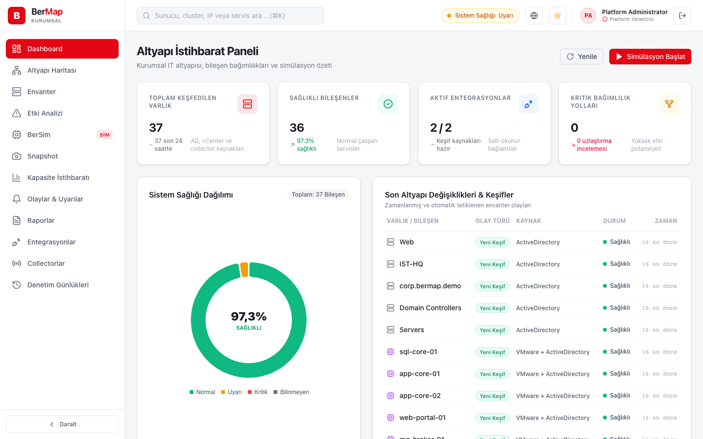
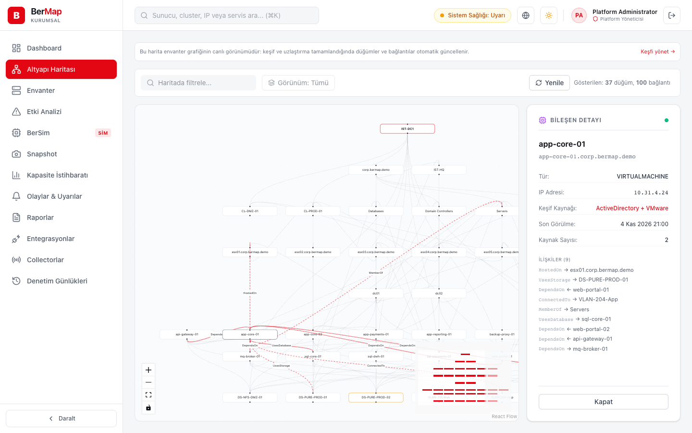
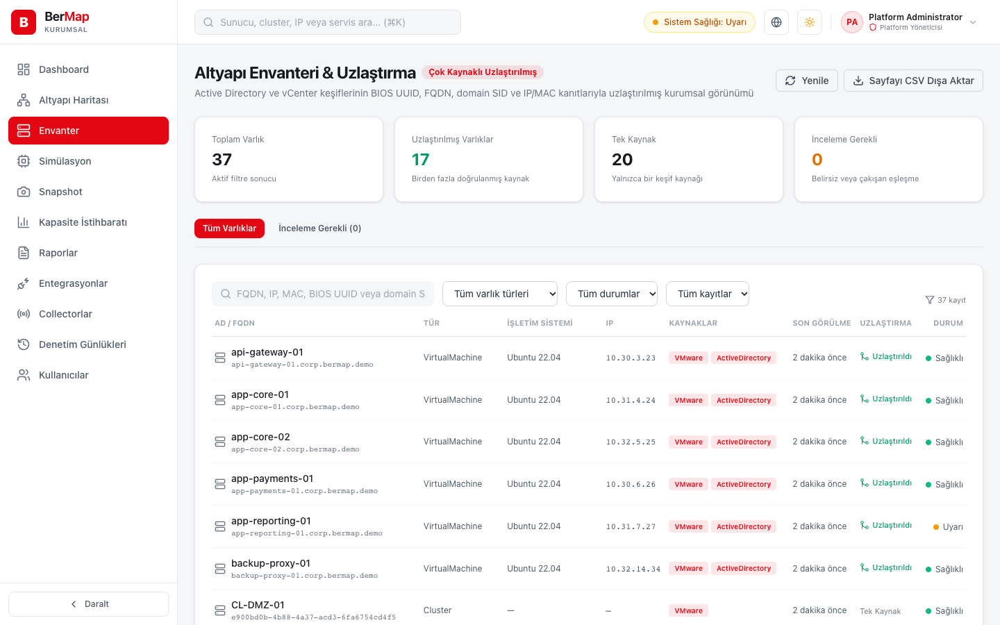
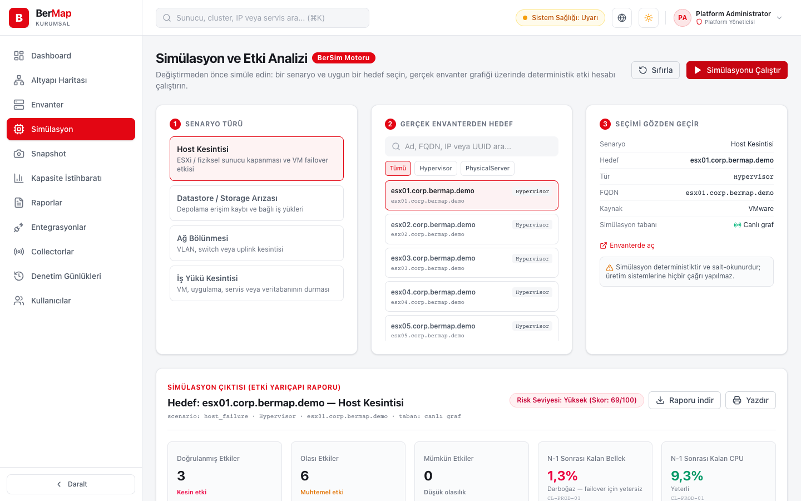
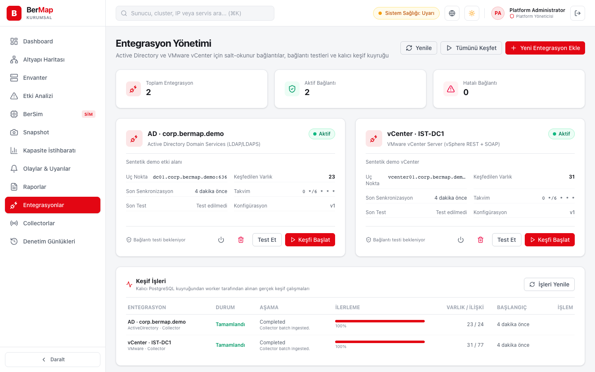
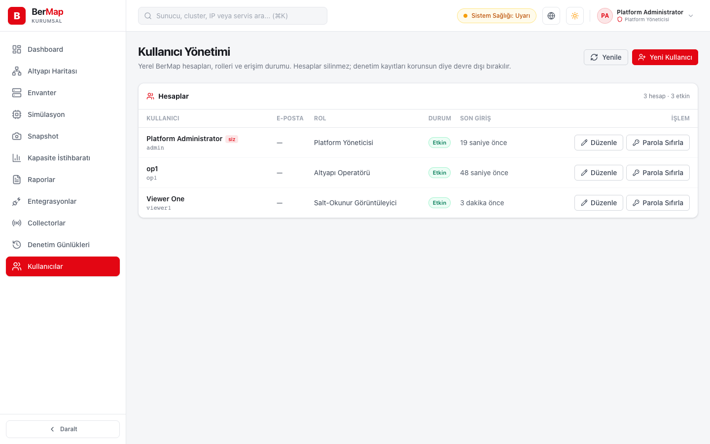
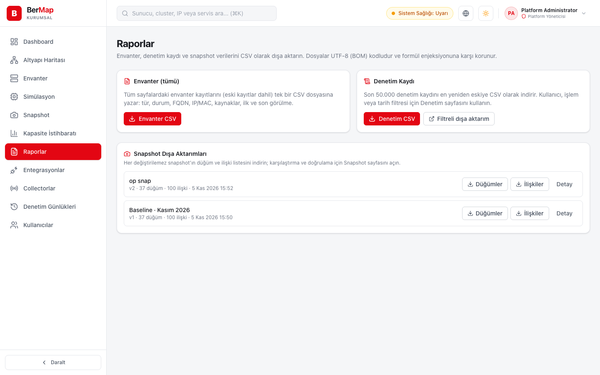

<p align="center"></p>

<h1 align="center">BerMap</h1>

<p align="center"><b>Altyapınızı haritalayın. Değişikliği önce simülasyonda deneyin.</b><br>Kurum içi keşif · Bağımlılık haritası · Etki ve kapasite simülasyonu</p>

<p align="center">
  <a href="https://github.com/BerkayAtag/BerMap/releases/latest"><b>Sunucu paketini indir (0.4.0)</b></a> ·
  <a href="https://berkayatag.github.io/BerMap/">Tanıtım sayfası</a> ·
  <a href="deploy/KURULUM.md">Kurulum</a> ·
  <a href="CHANGELOG.md">Sürüm geçmişi</a> ·
  <a href="SECURITY.md">Güvenlik</a>
</p>

<picture>
  <source media="(prefers-color-scheme: dark)" srcset="site/assets/dashboard-dark.png">
  
</picture>

BerMap, Active Directory ve VMware vCenter'ı **salt okunur** keşfeder; sunucuları, sanal makineleri, depolamayı, ağları ve uygulama bağımlılıklarını tek bir grafta uzlaştırır. Bir host, datastore, ağ ya da iş yükü düşerse neyin etkileneceğini ve cluster'da failover için kapasite kalıp kalmadığını üretime dokunmadan görürsünüz. Tüm veriler kurum içinde kalır; çalışmak için internet gerekmez.

## Kurulum

[Son sürüm](https://github.com/BerkayAtag/BerMap/releases/latest) sayfasından sunucu paketini ve `SHA256SUMS.txt` dosyasını indirin. Paketler self-contained'dir (sunucuda .NET gerekmez) ve web konsolunu içerir. Tek ön koşul erişilebilir bir **PostgreSQL 16+** sunucusudur; BerMap veritabanını ve şemayı ilk açılışta kurar.

**Windows Server** — `BerMap-Server-0.4.0-win-x64.zip` paketini açıp yönetici PowerShell'de:

```powershell
.\Install-BerMapServer.ps1 -DbHost localhost -DbUser bermap
```

**Linux (systemd)** — `bermap-server-0.4.0-linux-x64.tar.gz` (veya `linux-arm64`):

```bash
sudo ./install.sh --db-host localhost --db-user bermap
```

Betik dosyaları kopyalar, yapılandırmayı yazar, **BerMapServer** Windows servisini ya da `bermap-server` systemd servisini kurar, sunucu hazır olana kadar bekler ve sonunda konsol adresini, ilk yönetici (`admin`) parolasını ve collector kayıt token'ını yazar. Aynı betik yükseltme için de kullanılır; yapılandırma, kasa ve veritabanı korunur. HTTPS, port, dizinler ve kaldırma: [kurulum rehberi](deploy/KURULUM.md).

### Collector kurulumu

Sunucunun doğrudan erişemediği ağlarda (şube, DMZ, ayrı forest) keşfi yerinde yapan collector, aynı sürüm sayfasında ayrı paketlerle gelir ve sunucuya yalnız dışarı yönlü HTTPS ile bağlanır. Sunucu kurulumunun yazdığı collector kayıt token'ıyla:

```powershell
.\Install-BerMapCollector.ps1 -ServerUrl https://bermap.corp.local -Name dc2-collector    # BerMap-Collector-<sürüm>-win-x64.zip
```

```bash
sudo BERMAP_ENROLLMENT_TOKEN='<token>' ./install.sh --server-url https://bermap.corp.local --name dc2-collector   # bermap-collector-<sürüm>-linux-x64.tar.gz
```

Betik **BerMapCollector** Windows servisini ya da `bermap-collector` systemd servisini kurar ve collector sunucuya kaydolana kadar bekler; collector konsolun **Collectorlar** sayfasında görünür. Entegrasyonlar sunucuda "collector yönetimli" olarak oluşturulup collector yapılandırmasına eklenir: [collector kurulum rehberi](deploy/KURULUM-COLLECTOR.md).

Her sürüm yayımlanmadan önce paketler temiz Windows ve Linux çalıştırıcılarında gerçekten kurulur, giriş yapılır, yükseltilir ve kaldırılır ([release iş akışı](.github/workflows/release.yml)).

## Ekranlar

| Altyapı Haritası | Envanter ve Uzlaştırma |
|---|---|
| <picture><source media="(prefers-color-scheme: dark)" srcset="site/assets/map-dark.png"></picture> | <picture><source media="(prefers-color-scheme: dark)" srcset="site/assets/inventory-dark.png"></picture> |
| **Simülasyon ve risk raporu** | **Entegrasyonlar** |
| <picture><source media="(prefers-color-scheme: dark)" srcset="site/assets/simulation-dark.png"></picture> | <picture><source media="(prefers-color-scheme: dark)" srcset="site/assets/integrations-dark.png"></picture> |
| **Kullanıcılar ve roller** | **Raporlar** |
| <picture><source media="(prefers-color-scheme: dark)" srcset="site/assets/users-dark.png"></picture> | <picture><source media="(prefers-color-scheme: dark)" srcset="site/assets/reports-dark.png"></picture> |

Ekranlar sentetik demo verisiyle gerçek uygulamadan alınmıştır. Konsol Türkçe ve İngilizce, aydınlık ve karanlık temada çalışır; telefonda menü çekmece olarak açılır.

## Özellikler

- **Salt okunur keşif:** Active Directory (LDAPS, sayfalı arama, birden çok domain/forest) ve vCenter (REST + PropertyCollector, host/VM kapasite metrikleri). Kaynak sistemlere hiçbir yazma yapılmaz; kimlik bilgileri AES-256-GCM ile şifreli kasada tutulur.
- **Zamanlanmış keşif:** her entegrasyon için cron takvimi (sunucu saatiyle); kaçırılan çalışmalar yığılmaz, birden çok sunucuda tek kez çalışır. Uzak ağlar için **collector**: AD ve vCenter keşfini yerinde, kendi takvimiyle yapar, sonuçları sunucuya yalnız dışarı yönlü HTTPS ile gönderir; sunucuya ulaşamadığında yerel kuyrukta tutar.
- **Uzlaştırma:** aynı sunucu AD'de bilgisayar, vCenter'da VM olarak görünse de SID, BIOS UUID ve FQDN ile tek düğüm olur. Yalnız ada dayanan eşleşmeler otomatik birleştirilmez, incelemeye düşer.
- **Altyapı haritası ve envanter:** katmanlı bağımlılık haritası, filtre, düğüm detayı; envanterde arama, filtre, CSV dışa aktarım ve inceleme kuyruğu.
- **Simülasyon (BerSim):** host, datastore, ağ ve iş yükü kesintisi senaryoları. Doğrudan, olası ve mümkün etkiler bağımlılık yollarıyla; host arızasında cluster'ın **N-1** CPU/RAM payı ve HA durumu; risk skoru ve öneriler. Simülasyon güncel graf ya da geçmiş bir **snapshot** üzerinde çalışır. Sonuç **yazdırılabilir değişiklik risk raporu** ya da Markdown olarak indirilir.
- **Snapshot:** grafın değişmez, hash'li anlık görüntüleri; iki snapshot'ı karşılaştırma ve bütünlük doğrulama.
- **Kullanıcılar ve roller:** yerel hesaplar (PBKDF2), Platform Yöneticisi, Entegrasyon Yöneticisi, Altyapı Operatörü, Güvenlik Denetçisi, Salt Okunur roller; parola değiştirme ve sıfırlama. Devre dışı bırakılan hesap 30 saniye içinde erişimini kaybeder.
- **Denetim ve raporlar:** giriş, kullanıcı, entegrasyon, keşif ve snapshot işlemlerinin denetim kaydı (filtre, sayfalama, CSV); envanter, denetim ve snapshot dışa aktarımları (UTF-8, formül enjeksiyonuna karşı korumalı).

## Mimari

```
Active Directory (LDAPS 636) ─┐                         ┌─ Web konsolu (HTTPS)
vCenter (HTTPS 443) ──────────┼─► BerMap sunucusu ◄─────┤
Uzak ağ ── Collector ─────────┘   API · keşif işçisi ·   └─ Yönetici / operatör
          (dışarı yönlü HTTPS)     zamanlayıcı · BerSim
                                         │
                                    PostgreSQL 16+
```

Tek bir .NET 10 sunucusu (modüler monolit) API'yi, keşif işçisini, zamanlayıcıyı ve web konsolunu sunar; tüm durum PostgreSQL'dedir. Ayrıntılar: [mimari belgeler](docs/architecture), [ADR'ler](docs/adr).

## Geliştirme

Gerekenler: .NET 10 SDK, Node.js 20+, PostgreSQL 16+ (`docker run -d -p 5432:5432 -e POSTGRES_USER=bermap_dev -e POSTGRES_PASSWORD=bermap_dev -e POSTGRES_DB=bermap_dev postgres:17-alpine`).

```bash
cd src/BerMap.Api && dotnet run --launch-profile http        # http://localhost:5294
cd src/BerMap.Web && npm install && npm run dev               # http://localhost:3000
```

- İlk açılışta migration'lar uygulanır, roller ve `admin` hesabı oluşturulur. Parola `BerMap:Bootstrap:AdminPassword` ile verilmezse geliştirmede `src/BerMap.Api/.bermap-vault/initial-admin-password.txt` dosyasına yazılır.
- Konsol `/api` isteklerini `BERMAP_API_URL` adresine (varsayılan `http://localhost:5294`) yönlendirir.
- Testler: `dotnet test BerMap.slnx` (PostgreSQL entegrasyon testleri `BERMAP_TEST_CONNECTION_STRING` tanımlıysa çalışır), `cd src/BerMap.Web && npm run lint && npm test && npm run build`.
- Uçtan uca testler: `tests/e2e` (Playwright) konsolun tüm işlevlerini gerçek sunucu ve PostgreSQL üzerinde dener; CI'da paketlenmiş sunucuya karşı çalışır. Ayrıntı: [tests/e2e/README.md](tests/e2e/README.md).
- Sunucu paketi: `deploy/package.sh <sürüm> <win-x64|linux-x64|linux-arm64> out` (önce web konsolunu derleyin).

Proje yapısı: `src/BerMap.Api` (sunucu), `BerMap.Application`/`Domain`/`Infrastructure` (iş mantığı ve veri), `BerMap.Integrations` (AD ve VMware adaptörleri), `BerMap.Simulation` (BerSim), `BerMap.Collector`, `BerMap.Web` (konsol), `deploy` (paketleme ve kurulum), `site` (tanıtım sayfası).

## Bilinen sınırlar

- Yalnız Active Directory ve VMware vCenter adaptörleri vardır; Zabbix, SCCM/MECM, SQL Server ve ağ cihazı adaptörleri planlanmaktadır.
- Konsol girişi yerel hesaplarladır (AD ile giriş, MFA yoktur). Paketler kod imzalı değildir.
- Gerçek AD/vCenter ortamında kabul testi kurumunuzun pilot ortamında yapılmalıdır.

## Lisans

Tescilli yazılım. © 2026 Berkay Atağ. Tüm hakları saklıdır. Kaynak kod inceleme amacıyla yayımlanmıştır; kullanma, kopyalama veya dağıtma lisansı verilmez.
