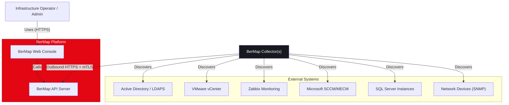
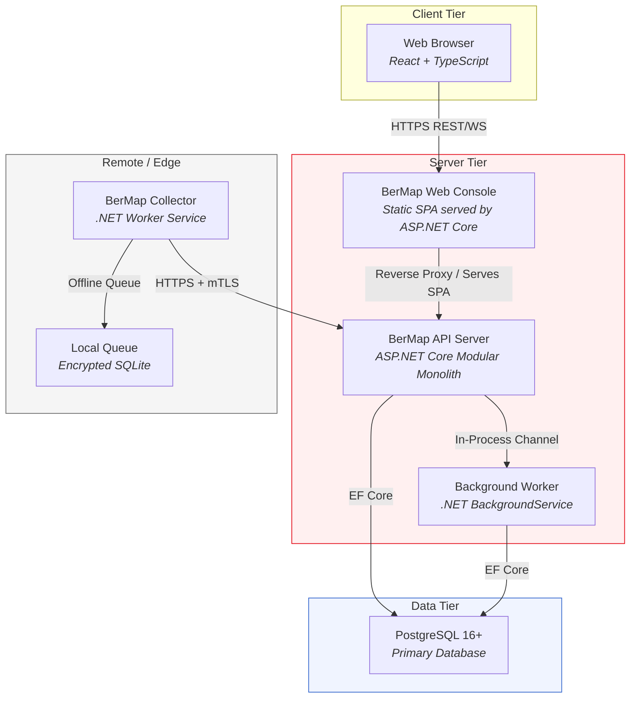

# 01 — System Overview

> **BerMap — Enterprise Infrastructure Intelligence & Digital Twin Platform**
>
> *"Discover. Map. Analyze. Simulate. Predict."*

---

## 1. Product Description

BerMap is an on-premises, air-gapped enterprise platform that automatically discovers IT infrastructure, builds a unified dependency graph, and provides a deterministic Digital Twin simulation engine. It enables infrastructure teams to understand the full topology of their environment—physical hosts, virtual machines, applications, databases, network devices, and their interconnections—and to answer **"what happens if…?"** questions *before* making changes.

BerMap and **BerTwin** (the simulation engine) are a **single integrated product**. Simulation is not a bolt-on module; it is a core capability that operates on the same dependency graph built by discovery.

### Core Capabilities

| Capability | Description |
|---|---|
| **Discovery** | Agentless and collector-based discovery of infrastructure via integration adapters (AD, vCenter, Zabbix, SCCM, SQL Server, etc.) |
| **Dependency Graph** | Typed node-edge graph model representing all infrastructure entities and their relationships |
| **Impact Analysis** | Traverse the dependency graph to determine the blast radius of any component failure |
| **Digital Twin (BerTwin)** | Snapshot-based deterministic simulation engine — model failures, migrations, and capacity changes before execution |
| **Capacity Intelligence** | Track resource utilization trends, forecast exhaustion, and plan capacity |
| **Event Correlation** | Correlate monitoring events across infrastructure layers to surface root causes |
| **Reporting** | Export topology maps, impact reports, simulation results, and compliance data |

---

## 2. High-Level Architecture

### 2.1 C4 — Context Diagram

### 2.2 C4 — Container Diagram

---

## 3. Key Components

| Component | Technology | Responsibility |
|---|---|---|
| **BerMap Web Console** | React 18+, TypeScript, Vite, Tailwind CSS, React Flow | Interactive SPA: topology visualization, simulation studio, dashboards, administration |
| **BerMap API Server** | ASP.NET Core (.NET 10 LTS), Modular Monolith | REST API, authentication, authorization, business logic, module orchestration |
| **Background Worker** | .NET `BackgroundService` | Discovery job execution, scheduled sync, snapshot generation, capacity metric aggregation |
| **BerMap Collector** | .NET Worker Service | Remote data collection agent; connects to infrastructure sources, submits data to API Server |
| **PostgreSQL** | PostgreSQL 16+ with JSONB | Primary data store: graph model, configuration, audit logs, simulation snapshots |

---

## 4. Technology Stack

| Layer | Technology | Version / Notes |
|---|---|---|
| **Runtime** | .NET | 10 LTS |
| **Web Framework** | ASP.NET Core | Modular Monolith |
| **ORM** | Entity Framework Core | Code-first migrations |
| **Database** | PostgreSQL | 16+ (Npgsql provider) |
| **Frontend Framework** | React | 18+ with TypeScript |
| **Build Tool** | Vite | Fast HMR, optimized builds |
| **CSS Framework** | Tailwind CSS | Custom red/white theme tokens |
| **Graph Visualization** | React Flow | Interactive topology rendering |
| **Collector Queue** | SQLite | Encrypted offline queue |
| **Certificate Auth** | mTLS | Collector ↔ Server communication |
| **Installer** | MSI / NSIS / WiX | Windows offline installer |
| **Containerization** | Docker Compose | Linux secondary deployment |
| **Source Control** | Git | Monorepo |

---

## 5. Non-Functional Requirements Summary

| Requirement | Target |
|---|---|
| **Deployment Model** | 100% on-premises, air-gapped, offline-capable |
| **Availability** | Single-server; no built-in HA (enterprise HA via external load balancer in future) |
| **Scalability** | 30,000+ nodes, 100,000+ relationships in a single instance |
| **Performance** | Graph traversal < 2s for 5-hop queries; simulation execution < 30s for single-host failure |
| **Security** | TLS 1.2 minimum (TLS 1.3 preferred); mTLS for collectors; RBAC; full audit logging |
| **Compliance** | WCAG AA for UI; audit trail for all state changes |
| **Data Retention** | Configurable per data type (audit logs, snapshots, metrics) |
| **Backup** | Built-in pg_dump wrapper for scheduled backups |
| **Upgrade** | Zero-downtime not required; maintenance-window upgrade with rollback capability |
| **Browser Support** | Chrome 90+, Edge 90+, Firefox 90+ (latest two major versions) |

---

## 6. Design Principles

1. **Offline-First** — Every feature must work without internet access. No CDN, no telemetry, no external API calls.
2. **Deterministic Simulation** — BerTwin simulation results are reproducible given the same snapshot and scenario. AI interprets results but never replaces the engine.
3. **Adapter Isolation** — A failure in one integration adapter must not affect discovery from other adapters.
4. **Schema Extensibility** — JSONB metadata columns allow any integration to store arbitrary properties without schema changes.
5. **Least Privilege** — RBAC enforced at API layer; collectors authenticate with scoped certificates; database credentials are encrypted at rest.
6. **Auditability** — Every state mutation is logged with actor, action, timestamp, and outcome.
