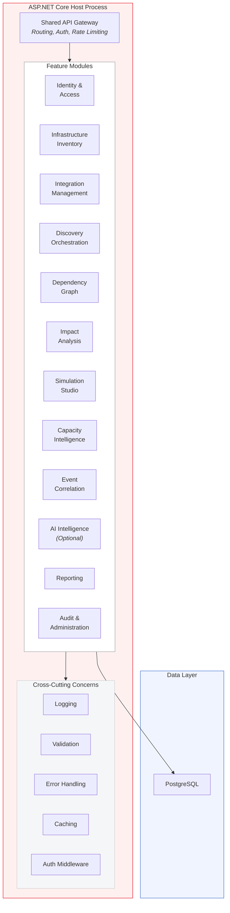
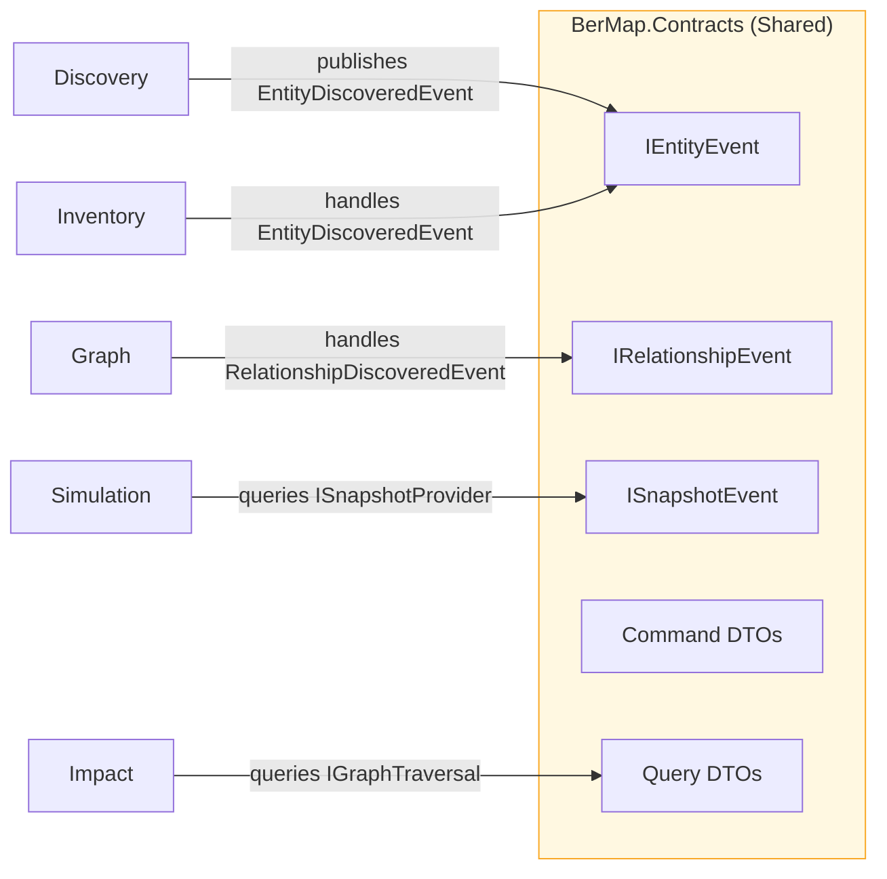
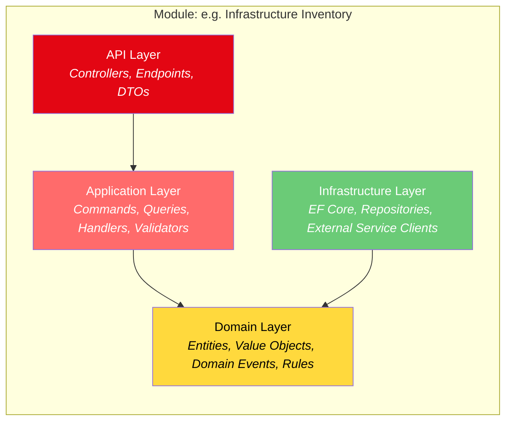

# 02 — Component Architecture

## 1. Modular Monolith Overview

BerMap follows the **Modular Monolith** pattern: a single deployable unit composed of loosely-coupled, vertically-sliced modules. Each module owns its domain, data access, and API surface while sharing a common hosting process and infrastructure.



---

## 2. Module Inventory

| # | Module | Namespace | Responsibilities |
|---|---|---|---|
| 1 | **Identity & Access** | `BerMap.Modules.Identity` | User management, authentication (local, LDAPS, Windows Integrated), RBAC, session management, password policies |
| 2 | **Infrastructure Inventory** | `BerMap.Modules.Inventory` | Entity CRUD, entity type registry, metadata management, entity lifecycle (active, decommissioned, archived) |
| 3 | **Integration Management** | `BerMap.Modules.Integration` | Integration adapter registry, credential storage, connection testing, adapter configuration, health monitoring |
| 4 | **Discovery Orchestration** | `BerMap.Modules.Discovery` | Discovery job scheduling, job execution pipeline, progress tracking, entity reconciliation, delta detection |
| 5 | **Dependency Graph** | `BerMap.Modules.Graph` | Graph construction, relationship CRUD, graph traversal (recursive CTE), topology queries, graph validation |
| 6 | **Impact Analysis** | `BerMap.Modules.Impact` | Blast radius calculation, upstream/downstream traversal, impact classification, dependency chain resolution |
| 7 | **Simulation Studio** | `BerMap.Modules.Simulation` | Snapshot creation, scenario definition, deterministic simulation engine, result comparison, what-if analysis |
| 8 | **Capacity Intelligence** | `BerMap.Modules.Capacity` | Resource metric collection, utilization trending, capacity forecasting, threshold alerting, capacity planning |
| 9 | **Event Correlation** | `BerMap.Modules.Events` | Event ingestion from monitoring sources, timeline correlation, root cause suggestion, event deduplication |
| 10 | **AI Intelligence** | `BerMap.Modules.AI` | *(Optional)* Natural language queries, anomaly detection, pattern recognition, simulation result interpretation |
| 11 | **Reporting** | `BerMap.Modules.Reporting` | Report templates, PDF/Excel export, scheduled reports, topology map export, compliance reports |
| 12 | **Audit & Administration** | `BerMap.Modules.Admin` | Audit log management, system configuration, license management, backup orchestration, system health dashboard |

---

## 3. Module Communication Patterns

Modules communicate through **Application Contracts** — shared interfaces and DTOs defined in a contracts assembly. There are no direct module-to-module dependencies.



### Communication Mechanisms

| Mechanism | Use Case | Implementation |
|---|---|---|
| **In-Process Events** | Module A notifies Module B of a state change | `MediatR` INotification / custom event bus |
| **Direct Query (via Contract Interface)** | Module A reads data owned by Module B | Interface in `BerMap.Contracts`, implemented in Module B, resolved via DI |
| **Shared Database Schema** | ❌ **Not allowed** | Each module owns its tables; cross-module reads go through contract interfaces |
| **Background Job Queue** | Long-running operations triggered by one module for another | `IBackgroundJobQueue` contract + `BackgroundService` implementation |

### Rules

1. Modules **MUST NOT** reference each other's assemblies directly.
2. All inter-module communication goes through `BerMap.Contracts`.
3. Each module registers its own EF Core `DbContext` scoped to its tables.
4. Shared entities (e.g., `UserId`, `TenantId`) are defined as value objects in Contracts.

---

## 4. Clean Architecture Layers (Per Module)

Each module follows a four-layer Clean Architecture:



| Layer | Depends On | Contains |
|---|---|---|
| **API** | Application | ASP.NET Core controllers/minimal API endpoints, request/response DTOs, input validation |
| **Application** | Domain | MediatR command/query handlers, application services, mapping profiles, business workflow orchestration |
| **Domain** | *(nothing)* | Domain entities, value objects, domain events, business rules, repository interfaces |
| **Infrastructure** | Domain | EF Core `DbContext`, repository implementations, adapter clients, file system access |

### Project Structure Example

```
src/
├── BerMap.Host/                          # ASP.NET Core host (entry point)
├── BerMap.Contracts/                     # Shared contracts, events, DTOs
├── BerMap.SharedKernel/                  # Base classes, common utilities
│
├── Modules/
│   ├── BerMap.Modules.Identity/
│   │   ├── BerMap.Modules.Identity.Api/
│   │   ├── BerMap.Modules.Identity.Application/
│   │   ├── BerMap.Modules.Identity.Domain/
│   │   └── BerMap.Modules.Identity.Infrastructure/
│   │
│   ├── BerMap.Modules.Inventory/
│   │   ├── BerMap.Modules.Inventory.Api/
│   │   ├── BerMap.Modules.Inventory.Application/
│   │   ├── BerMap.Modules.Inventory.Domain/
│   │   └── BerMap.Modules.Inventory.Infrastructure/
│   │
│   ├── BerMap.Modules.Graph/
│   │   └── ...
│   └── ... (other modules follow same structure)
│
├── BerMap.Collector/                     # Collector worker service
│
└── clients/
    └── bermap-web/                       # React + Vite frontend
```

---

## 5. Cross-Cutting Concerns

### 5.1 Logging

| Aspect | Implementation |
|---|---|
| Framework | `Microsoft.Extensions.Logging` with Serilog sink |
| Structured Logging | All log entries include `CorrelationId`, `UserId`, `ModuleName` |
| Log Levels | Trace, Debug, Information, Warning, Error, Critical |
| Storage | Rolling file (local), optionally forwarded to syslog |
| Sensitive Data | Credentials and PII are **never** logged; use `[Redacted]` placeholders |

### 5.2 Validation

| Aspect | Implementation |
|---|---|
| Input Validation | FluentValidation on all command/query DTOs |
| Domain Validation | Domain entities enforce invariants via guard clauses |
| API Validation | ASP.NET Core model binding + `ProblemDetails` responses |
| Cross-Field Validation | FluentValidation `RuleSet` for complex validations |

### 5.3 Error Handling

| Aspect | Implementation |
|---|---|
| Global Handler | ASP.NET Core exception middleware → `ProblemDetails` (RFC 7807) |
| Domain Errors | Custom `DomainException` hierarchy, caught and mapped at Application layer |
| Infrastructure Errors | Wrapped in `InfrastructureException`, logged with full context |
| Unhandled Errors | Caught at host level, logged as Critical, generic 500 returned to client |

### 5.4 Caching

| Aspect | Implementation |
|---|---|
| In-Memory Cache | `IMemoryCache` for frequently-read reference data (entity types, roles) |
| Distributed Cache | Not required (single-server deployment); `IMemoryCache` suffices |
| Cache Invalidation | Event-driven: module events trigger cache eviction in consuming modules |
| Cache Duration | Configurable per data type; default 5 minutes for reference data |
