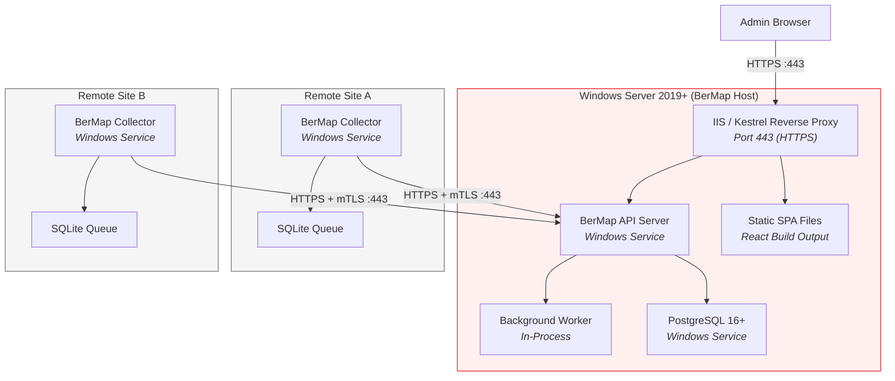
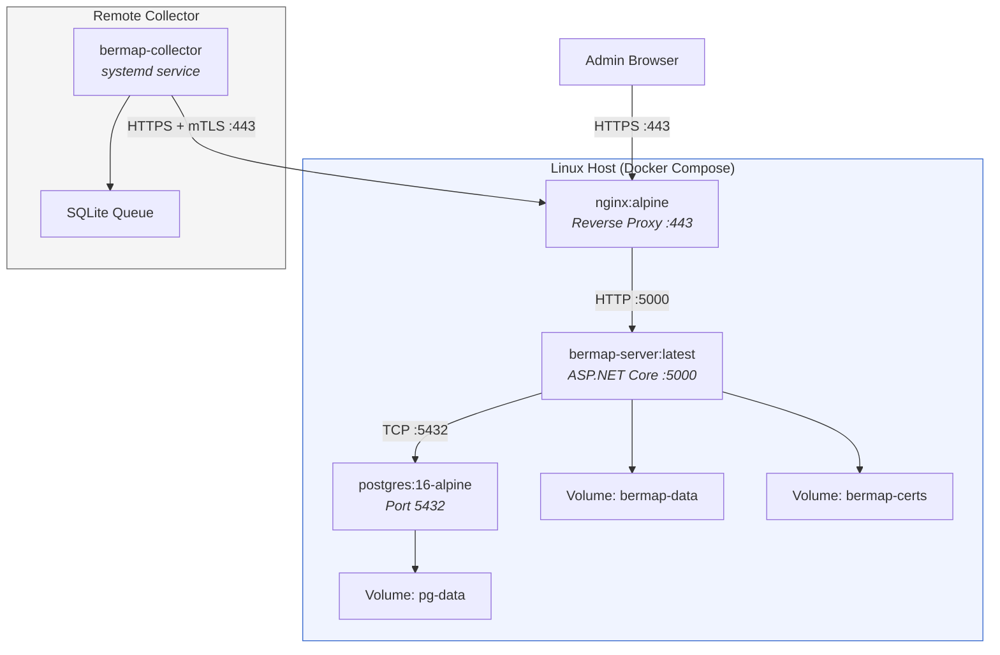
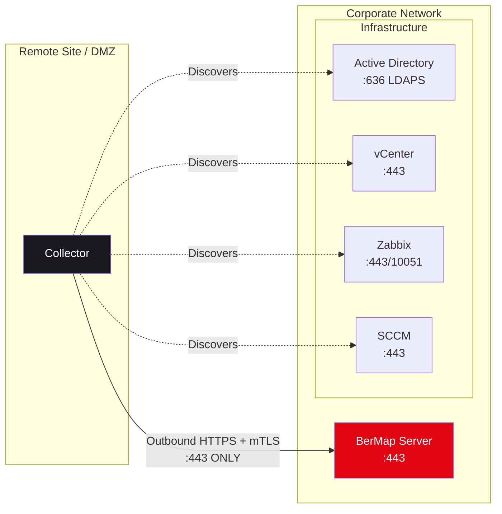

# 03 — Deployment Architecture

## 1. Deployment Models

BerMap supports two deployment models:

| Model | Priority | Target Environment |
|---|---|---|
| **Windows Server (Native)** | Primary | Enterprise Windows Server environments (air-gapped) |
| **Linux Docker Compose** | Secondary | Linux-based environments or dev/test setups |

Both models are **100% offline-capable**. All dependencies are bundled in the installer/image.

---

## 2. Windows Server Deployment Topology



### Windows Service Configuration

| Service Name | Display Name | Startup Type | Account |
|---|---|---|---|
| `BerMapServer` | BerMap API Server | Automatic (Delayed Start) | `NT SERVICE\BerMapServer` (managed service account) |
| `BerMapCollector` | BerMap Collector | Automatic | `NT SERVICE\BerMapCollector` (managed service account) |
| `postgresql-x64-16` | PostgreSQL 16 | Automatic | `NT SERVICE\postgresql-x64-16` |

---

## 3. Linux Docker Compose Deployment Topology



### Docker Compose Services

```yaml
# docker-compose.yml (simplified)
version: "3.9"
services:
  bermap-server:
    image: bermap-server:${BERMAP_VERSION}
    ports:
      - "5000:5000"
    environment:
      - ConnectionStrings__BerMap=Host=postgres;Database=bermap;...
      - ASPNETCORE_URLS=http://+:5000
    volumes:
      - bermap-data:/app/data
      - bermap-certs:/app/certs
    depends_on:
      - postgres
    restart: unless-stopped

  postgres:
    image: postgres:16-alpine
    environment:
      - POSTGRES_DB=bermap
      - POSTGRES_USER=bermap
      - POSTGRES_PASSWORD_FILE=/run/secrets/pg_password
    volumes:
      - pg-data:/var/lib/postgresql/data
    restart: unless-stopped

  nginx:
    image: nginx:alpine
    ports:
      - "443:443"
    volumes:
      - ./nginx.conf:/etc/nginx/nginx.conf:ro
      - bermap-certs:/etc/nginx/certs:ro
    depends_on:
      - bermap-server
    restart: unless-stopped

volumes:
  bermap-data:
  bermap-certs:
  pg-data:
```

---

## 4. Collector Deployment Patterns

### 4.1 Windows Collector (Windows Service)

| Aspect | Detail |
|---|---|
| Installation | MSI installer; silent install supported |
| Service Name | `BerMapCollector` |
| Configuration | `appsettings.json` + environment overrides |
| Certificate Store | Windows Certificate Store (Local Machine) |
| Offline Queue | `%ProgramData%\BerMap\Collector\queue.db` (encrypted SQLite) |
| Logs | `%ProgramData%\BerMap\Collector\logs\` (rolling files) |

### 4.2 Linux Collector (systemd)

| Aspect | Detail |
|---|---|
| Installation | `.tar.gz` bundle with install script |
| Service File | `/etc/systemd/system/bermap-collector.service` |
| Configuration | `/etc/bermap/collector/appsettings.json` |
| Certificate Store | `/etc/bermap/collector/certs/` |
| Offline Queue | `/var/lib/bermap/collector/queue.db` (encrypted SQLite) |
| Logs | journald + `/var/log/bermap/collector/` |

---

## 5. Network Topology



> [!IMPORTANT]
> Collectors initiate **outbound-only** connections to the BerMap Server. The server **never** initiates connections to collectors. This simplifies firewall rules and supports NAT/DMZ deployments.

---

## 6. Port Requirements

| Port | Protocol | Direction | Purpose |
|---|---|---|---|
| **443** | HTTPS | Inbound to Server | Web UI + API access |
| **443** | HTTPS + mTLS | Collector → Server | Collector data submission & registration |
| **5432** | TCP | Server ↔ PostgreSQL | Database (localhost or internal network only) |
| **636** | TCP | Server/Collector → AD | LDAPS authentication & discovery |
| **443** | HTTPS | Collector → vCenter | VMware API discovery |
| **443/10051** | HTTPS/TCP | Collector → Zabbix | Monitoring data collection |
| **443** | HTTPS | Collector → SCCM | SCCM API discovery |
| **1433** | TCP | Collector → SQL Server | SQL Server discovery |
| **161** | UDP | Collector → Network Devices | SNMP discovery |

---

## 7. Hardware Specifications

### Minimum (≤5,000 nodes)

| Resource | Server | Collector |
|---|---|---|
| **CPU** | 4 cores | 2 cores |
| **RAM** | 8 GB | 4 GB |
| **Disk** | 100 GB SSD | 20 GB |
| **OS** | Windows Server 2019+ / Ubuntu 22.04+ | Windows Server 2016+ / Ubuntu 20.04+ |

### Recommended (5,000–30,000 nodes)

| Resource | Server | Collector |
|---|---|---|
| **CPU** | 8+ cores | 2–4 cores |
| **RAM** | 16–32 GB | 4–8 GB |
| **Disk** | 500 GB SSD | 50 GB |
| **OS** | Windows Server 2022 / Ubuntu 24.04 | Windows Server 2022 / Ubuntu 22.04+ |

---

## 8. Offline Installer Workflow

### Windows Offline Bundle

```
BerMap-Setup-v1.0.0.exe     (~400 MB)
├── dotnet-runtime-10.x.x-win-x64.exe
├── postgresql-16.x-win-x64.exe
├── bermap-server-1.0.0.zip
├── bermap-web-1.0.0.zip     (pre-built SPA)
├── bermap-collector-1.0.0.zip
├── install.ps1
└── checksums.sha256
```

### Silent Installation Parameters

```powershell
.\BerMap-Setup.exe `
    /SILENT `
    /DB_MODE=bundled `           # or "existing"
    /DB_HOST=localhost `
    /DB_PORT=5432 `
    /DB_NAME=bermap `
    /DB_USER=bermap `
    /DB_PASSWORD=<password> `
    /INSTALL_DIR="C:\Program Files\BerMap" `
    /DATA_DIR="C:\ProgramData\BerMap" `
    /HTTPS_PORT=443 `
    /CERT_PATH=<path-to-pfx> `
    /CERT_PASSWORD=<password> `
    /ADMIN_USERNAME=admin `
    /ADMIN_PASSWORD=<password> `
    /INSTALL_COLLECTOR=true `
    /LOG_FILE="C:\Temp\bermap-install.log"
```

### Linux Offline Bundle

```bash
bermap-1.0.0-linux-x64.tar.gz
├── docker-compose.yml
├── images/
│   ├── bermap-server-1.0.0.tar     (docker save)
│   ├── postgres-16-alpine.tar
│   └── nginx-alpine.tar
├── install.sh
└── checksums.sha256
```

```bash
# Load and start
./install.sh --load-images --data-dir /opt/bermap/data
```
