# 04 — Database Design

## 1. Design Principles

| Principle | Implementation |
|---|---|
| **UUID Primary Keys** | All tables use `uuid` (v7 for time-ordering where beneficial) as primary key |
| **JSONB Extensibility** | Every entity/relationship table includes a `metadata jsonb` column for adapter-specific data |
| **Soft Deletes** | Core entities use `is_deleted` + `deleted_at` rather than physical deletes |
| **Audit Trail** | All mutations logged to `audit_logs` with actor, action, timestamp, outcome |
| **Tenant Isolation** | All data tables include `tenant_id` for future multi-tenancy (single-tenant MVP) |
| **Timestamps** | All tables include `created_at` and `updated_at` (UTC, timestamptz) |

---

## 2. Schema Overview

```mermaid
erDiagram
    tenants ||--o{ users : "has"
    users ||--o{ user_roles : "assigned"
    roles ||--o{ user_roles : "granted_to"
    roles ||--o{ permissions : "has"

    tenants ||--o{ integrations : "owns"
    integrations ||--o{ integration_configs : "configured_by"
    integrations ||--o{ credentials : "authenticates_with"

    tenants ||--o{ collectors : "deploys"
    collectors ||--o{ collector_heartbeats : "reports"

    tenants ||--o{ entities : "contains"
    entities ||--o{ entity_metadata : "extended_by"
    entities ||--o{ entity_sources : "discovered_from"

    tenants ||--o{ relationships : "maps"
    relationships ||--o{ relationship_metadata : "extended_by"

    entities ||--o{ relationships : "source_node"
    entities ||--o{ relationships : "target_node"

    tenants ||--o{ snapshots : "versions"
    snapshots ||--o{ snapshot_entities : "captures"
    snapshots ||--o{ snapshot_relationships : "captures"

    tenants ||--o{ simulations : "runs"
    simulations ||--o{ simulation_scenarios : "defines"
    simulations ||--o{ simulation_results : "produces"

    tenants ||--o{ discovery_jobs : "schedules"
    discovery_jobs ||--o{ discovery_progress : "tracks"

    tenants ||--o{ capacity_metrics : "collects"
    tenants ||--o{ capacity_snapshots : "aggregates"

    tenants ||--o{ audit_logs : "records"
    tenants ||--o{ events : "captures"
```



---

## 3. Core Table Definitions

### 3.1 Identity & Access

```sql
-- Tenants (single-tenant MVP, multi-tenant ready)
CREATE TABLE tenants (
    id              uuid PRIMARY KEY DEFAULT gen_random_uuid(),
    name            varchar(256) NOT NULL,
    slug            varchar(64) NOT NULL UNIQUE,
    is_active       boolean NOT NULL DEFAULT true,
    settings        jsonb NOT NULL DEFAULT '{}',
    created_at      timestamptz NOT NULL DEFAULT now(),
    updated_at      timestamptz NOT NULL DEFAULT now()
);

-- Users
CREATE TABLE users (
    id              uuid PRIMARY KEY DEFAULT gen_random_uuid(),
    tenant_id       uuid NOT NULL REFERENCES tenants(id),
    username        varchar(256) NOT NULL,
    email           varchar(512),
    display_name    varchar(512),
    password_hash   varchar(1024),          -- NULL for AD/Windows auth users
    auth_provider   varchar(64) NOT NULL DEFAULT 'local',  -- local | ldap | windows
    external_id     varchar(512),           -- AD objectGUID / SID
    is_active       boolean NOT NULL DEFAULT true,
    last_login_at   timestamptz,
    created_at      timestamptz NOT NULL DEFAULT now(),
    updated_at      timestamptz NOT NULL DEFAULT now(),
    UNIQUE(tenant_id, username)
);

-- Roles
CREATE TABLE roles (
    id              uuid PRIMARY KEY DEFAULT gen_random_uuid(),
    tenant_id       uuid NOT NULL REFERENCES tenants(id),
    name            varchar(128) NOT NULL,
    description     text,
    is_system       boolean NOT NULL DEFAULT false,  -- system roles cannot be deleted
    created_at      timestamptz NOT NULL DEFAULT now(),
    updated_at      timestamptz NOT NULL DEFAULT now(),
    UNIQUE(tenant_id, name)
);

-- User-Role assignments
CREATE TABLE user_roles (
    id              uuid PRIMARY KEY DEFAULT gen_random_uuid(),
    user_id         uuid NOT NULL REFERENCES users(id),
    role_id         uuid NOT NULL REFERENCES roles(id),
    granted_by      uuid REFERENCES users(id),
    granted_at      timestamptz NOT NULL DEFAULT now(),
    UNIQUE(user_id, role_id)
);

-- Permissions
CREATE TABLE permissions (
    id              uuid PRIMARY KEY DEFAULT gen_random_uuid(),
    role_id         uuid NOT NULL REFERENCES roles(id),
    resource        varchar(128) NOT NULL,   -- e.g., 'entity', 'simulation', 'integration'
    action          varchar(64) NOT NULL,    -- e.g., 'read', 'write', 'delete', 'execute'
    created_at      timestamptz NOT NULL DEFAULT now(),
    UNIQUE(role_id, resource, action)
);
```

### 3.2 Integration Management

```sql
-- Integrations (registered data sources)
CREATE TABLE integrations (
    id              uuid PRIMARY KEY DEFAULT gen_random_uuid(),
    tenant_id       uuid NOT NULL REFERENCES tenants(id),
    name            varchar(256) NOT NULL,
    adapter_type    varchar(128) NOT NULL,   -- e.g., 'vmware_vcenter', 'active_directory'
    adapter_version varchar(32),
    is_enabled      boolean NOT NULL DEFAULT true,
    status          varchar(32) NOT NULL DEFAULT 'pending',  -- pending | connected | error | disabled
    last_sync_at    timestamptz,
    sync_interval   interval DEFAULT '1 hour',
    settings        jsonb NOT NULL DEFAULT '{}',
    created_at      timestamptz NOT NULL DEFAULT now(),
    updated_at      timestamptz NOT NULL DEFAULT now()
);

-- Integration configuration (adapter-specific key-value)
CREATE TABLE integration_configs (
    id              uuid PRIMARY KEY DEFAULT gen_random_uuid(),
    integration_id  uuid NOT NULL REFERENCES integrations(id) ON DELETE CASCADE,
    config_key      varchar(256) NOT NULL,
    config_value    text NOT NULL,
    is_encrypted    boolean NOT NULL DEFAULT false,
    created_at      timestamptz NOT NULL DEFAULT now(),
    updated_at      timestamptz NOT NULL DEFAULT now(),
    UNIQUE(integration_id, config_key)
);

-- Credentials (encrypted at rest)
CREATE TABLE credentials (
    id              uuid PRIMARY KEY DEFAULT gen_random_uuid(),
    integration_id  uuid NOT NULL REFERENCES integrations(id) ON DELETE CASCADE,
    credential_type varchar(64) NOT NULL,    -- username_password | certificate | api_key | kerberos
    encrypted_data  bytea NOT NULL,          -- encrypted using DPAPI (Windows) or key file (Linux)
    encryption_key_id varchar(128),
    expires_at      timestamptz,
    created_at      timestamptz NOT NULL DEFAULT now(),
    updated_at      timestamptz NOT NULL DEFAULT now()
);
```

### 3.3 Collectors

```sql
-- Collectors
CREATE TABLE collectors (
    id              uuid PRIMARY KEY DEFAULT gen_random_uuid(),
    tenant_id       uuid NOT NULL REFERENCES tenants(id),
    name            varchar(256) NOT NULL,
    hostname        varchar(512),
    status          varchar(32) NOT NULL DEFAULT 'pending',  -- pending | active | inactive | revoked
    certificate_thumbprint varchar(128),
    approved_at     timestamptz,
    approved_by     uuid REFERENCES users(id),
    last_seen_at    timestamptz,
    version         varchar(32),
    settings        jsonb NOT NULL DEFAULT '{}',
    created_at      timestamptz NOT NULL DEFAULT now(),
    updated_at      timestamptz NOT NULL DEFAULT now()
);

-- Collector heartbeats
CREATE TABLE collector_heartbeats (
    id              uuid PRIMARY KEY DEFAULT gen_random_uuid(),
    collector_id    uuid NOT NULL REFERENCES collectors(id) ON DELETE CASCADE,
    status          varchar(32) NOT NULL,    -- healthy | degraded | error
    cpu_percent     decimal(5,2),
    memory_mb       integer,
    queue_depth     integer,
    active_jobs     integer,
    uptime_seconds  bigint,
    reported_at     timestamptz NOT NULL DEFAULT now()
);
```

### 3.4 Graph Model (Entities & Relationships)

```sql
-- Entities (Nodes)
CREATE TABLE entities (
    id              uuid PRIMARY KEY DEFAULT gen_random_uuid(),
    tenant_id       uuid NOT NULL REFERENCES tenants(id),
    entity_type     varchar(64) NOT NULL,    -- See graph model doc for types
    name            varchar(512) NOT NULL,
    display_name    varchar(512),
    fqdn            varchar(1024),
    status          varchar(32) NOT NULL DEFAULT 'active',  -- active | inactive | decommissioned | archived
    criticality     varchar(16) DEFAULT 'medium',           -- critical | high | medium | low
    metadata        jsonb NOT NULL DEFAULT '{}',
    first_seen_at   timestamptz NOT NULL DEFAULT now(),
    last_seen_at    timestamptz NOT NULL DEFAULT now(),
    is_deleted      boolean NOT NULL DEFAULT false,
    deleted_at      timestamptz,
    created_at      timestamptz NOT NULL DEFAULT now(),
    updated_at      timestamptz NOT NULL DEFAULT now()
);

-- Entity metadata (additional JSONB per source)
CREATE TABLE entity_metadata (
    id              uuid PRIMARY KEY DEFAULT gen_random_uuid(),
    entity_id       uuid NOT NULL REFERENCES entities(id) ON DELETE CASCADE,
    source          varchar(128) NOT NULL,   -- integration adapter that provided this
    metadata_key    varchar(256) NOT NULL,
    metadata_value  jsonb NOT NULL,
    collected_at    timestamptz NOT NULL DEFAULT now(),
    UNIQUE(entity_id, source, metadata_key)
);

-- Entity sources (which integrations discovered this entity)
CREATE TABLE entity_sources (
    id              uuid PRIMARY KEY DEFAULT gen_random_uuid(),
    entity_id       uuid NOT NULL REFERENCES entities(id) ON DELETE CASCADE,
    integration_id  uuid NOT NULL REFERENCES integrations(id),
    external_id     varchar(1024),           -- ID in the source system
    source_type     varchar(128) NOT NULL,
    confidence      decimal(3,2) NOT NULL DEFAULT 1.00,
    last_synced_at  timestamptz NOT NULL DEFAULT now(),
    UNIQUE(entity_id, integration_id)
);

-- Relationships (Edges)
CREATE TABLE relationships (
    id              uuid PRIMARY KEY DEFAULT gen_random_uuid(),
    tenant_id       uuid NOT NULL REFERENCES tenants(id),
    source_entity_id uuid NOT NULL REFERENCES entities(id),
    target_entity_id uuid NOT NULL REFERENCES entities(id),
    relationship_type varchar(64) NOT NULL,  -- HOSTED_ON, DEPENDS_ON, etc.
    direction       varchar(16) NOT NULL DEFAULT 'directed',  -- directed | bidirectional
    confidence      varchar(16) NOT NULL DEFAULT 'observed',  -- verified | observed | inferred
    discovery_source varchar(128),
    evidence        text,
    metadata        jsonb NOT NULL DEFAULT '{}',
    first_seen_at   timestamptz NOT NULL DEFAULT now(),
    last_seen_at    timestamptz NOT NULL DEFAULT now(),
    validation_status varchar(32) DEFAULT 'auto',  -- auto | manual_confirmed | manual_rejected
    is_deleted      boolean NOT NULL DEFAULT false,
    deleted_at      timestamptz,
    created_at      timestamptz NOT NULL DEFAULT now(),
    updated_at      timestamptz NOT NULL DEFAULT now()
);

-- Relationship metadata
CREATE TABLE relationship_metadata (
    id              uuid PRIMARY KEY DEFAULT gen_random_uuid(),
    relationship_id uuid NOT NULL REFERENCES relationships(id) ON DELETE CASCADE,
    source          varchar(128) NOT NULL,
    metadata_key    varchar(256) NOT NULL,
    metadata_value  jsonb NOT NULL,
    collected_at    timestamptz NOT NULL DEFAULT now(),
    UNIQUE(relationship_id, source, metadata_key)
);
```

### 3.5 Snapshots

```sql
-- Snapshots (point-in-time graph captures for simulation)
CREATE TABLE snapshots (
    id              uuid PRIMARY KEY DEFAULT gen_random_uuid(),
    tenant_id       uuid NOT NULL REFERENCES tenants(id),
    name            varchar(256) NOT NULL,
    description     text,
    snapshot_type   varchar(32) NOT NULL DEFAULT 'manual',  -- manual | scheduled | pre_simulation
    entity_count    integer NOT NULL DEFAULT 0,
    relationship_count integer NOT NULL DEFAULT 0,
    captured_at     timestamptz NOT NULL DEFAULT now(),
    captured_by     uuid REFERENCES users(id),
    expires_at      timestamptz,
    is_baseline     boolean NOT NULL DEFAULT false,
    metadata        jsonb NOT NULL DEFAULT '{}',
    created_at      timestamptz NOT NULL DEFAULT now()
);

-- Snapshot entities (frozen copy of entity state)
CREATE TABLE snapshot_entities (
    id              uuid PRIMARY KEY DEFAULT gen_random_uuid(),
    snapshot_id     uuid NOT NULL REFERENCES snapshots(id) ON DELETE CASCADE,
    entity_id       uuid NOT NULL REFERENCES entities(id),
    entity_data     jsonb NOT NULL,          -- full entity + metadata serialized
    UNIQUE(snapshot_id, entity_id)
);

-- Snapshot relationships (frozen copy of relationship state)
CREATE TABLE snapshot_relationships (
    id              uuid PRIMARY KEY DEFAULT gen_random_uuid(),
    snapshot_id     uuid NOT NULL REFERENCES snapshots(id) ON DELETE CASCADE,
    relationship_id uuid NOT NULL REFERENCES relationships(id),
    relationship_data jsonb NOT NULL,        -- full relationship + metadata serialized
    UNIQUE(snapshot_id, relationship_id)
);
```

### 3.6 Simulations

```sql
-- Simulations
CREATE TABLE simulations (
    id              uuid PRIMARY KEY DEFAULT gen_random_uuid(),
    tenant_id       uuid NOT NULL REFERENCES tenants(id),
    name            varchar(256) NOT NULL,
    description     text,
    snapshot_id     uuid NOT NULL REFERENCES snapshots(id),
    status          varchar(32) NOT NULL DEFAULT 'draft',  -- draft | running | completed | failed
    started_at      timestamptz,
    completed_at    timestamptz,
    created_by      uuid NOT NULL REFERENCES users(id),
    metadata        jsonb NOT NULL DEFAULT '{}',
    created_at      timestamptz NOT NULL DEFAULT now(),
    updated_at      timestamptz NOT NULL DEFAULT now()
);

-- Simulation scenarios (what-if conditions)
CREATE TABLE simulation_scenarios (
    id              uuid PRIMARY KEY DEFAULT gen_random_uuid(),
    simulation_id   uuid NOT NULL REFERENCES simulations(id) ON DELETE CASCADE,
    scenario_type   varchar(64) NOT NULL,    -- host_failure, maintenance, vm_migration, etc.
    target_entity_id uuid REFERENCES entities(id),
    parameters      jsonb NOT NULL DEFAULT '{}',
    sequence_order  integer NOT NULL DEFAULT 0,
    created_at      timestamptz NOT NULL DEFAULT now()
);

-- Simulation results
CREATE TABLE simulation_results (
    id              uuid PRIMARY KEY DEFAULT gen_random_uuid(),
    simulation_id   uuid NOT NULL REFERENCES simulations(id) ON DELETE CASCADE,
    affected_entity_id uuid NOT NULL REFERENCES entities(id),
    impact_level    varchar(16) NOT NULL,    -- confirmed | probable | possible | unknown
    impact_type     varchar(64) NOT NULL,    -- service_outage | degradation | no_impact | failover
    impact_path     jsonb NOT NULL DEFAULT '[]',  -- ordered list of entity IDs in the impact chain
    details         jsonb NOT NULL DEFAULT '{}',
    created_at      timestamptz NOT NULL DEFAULT now()
);
```

### 3.7 Discovery & Capacity

```sql
-- Discovery jobs
CREATE TABLE discovery_jobs (
    id              uuid PRIMARY KEY DEFAULT gen_random_uuid(),
    tenant_id       uuid NOT NULL REFERENCES tenants(id),
    integration_id  uuid NOT NULL REFERENCES integrations(id),
    collector_id    uuid REFERENCES collectors(id),
    job_type        varchar(32) NOT NULL DEFAULT 'full',  -- full | incremental
    status          varchar(32) NOT NULL DEFAULT 'pending',  -- pending | running | completed | failed | cancelled
    started_at      timestamptz,
    completed_at    timestamptz,
    entities_found  integer DEFAULT 0,
    entities_created integer DEFAULT 0,
    entities_updated integer DEFAULT 0,
    relationships_found integer DEFAULT 0,
    error_message   text,
    created_at      timestamptz NOT NULL DEFAULT now(),
    updated_at      timestamptz NOT NULL DEFAULT now()
);

-- Discovery progress tracking
CREATE TABLE discovery_progress (
    id              uuid PRIMARY KEY DEFAULT gen_random_uuid(),
    job_id          uuid NOT NULL REFERENCES discovery_jobs(id) ON DELETE CASCADE,
    phase           varchar(64) NOT NULL,
    status          varchar(32) NOT NULL DEFAULT 'running',
    items_total     integer,
    items_processed integer DEFAULT 0,
    message         text,
    reported_at     timestamptz NOT NULL DEFAULT now()
);

-- Capacity metrics (time-series style)
CREATE TABLE capacity_metrics (
    id              uuid PRIMARY KEY DEFAULT gen_random_uuid(),
    tenant_id       uuid NOT NULL REFERENCES tenants(id),
    entity_id       uuid NOT NULL REFERENCES entities(id),
    metric_type     varchar(64) NOT NULL,    -- cpu_percent, memory_percent, disk_percent, etc.
    metric_value    decimal(10,2) NOT NULL,
    collected_at    timestamptz NOT NULL DEFAULT now()
);

-- Capacity snapshots (aggregated)
CREATE TABLE capacity_snapshots (
    id              uuid PRIMARY KEY DEFAULT gen_random_uuid(),
    tenant_id       uuid NOT NULL REFERENCES tenants(id),
    entity_id       uuid NOT NULL REFERENCES entities(id),
    snapshot_date   date NOT NULL,
    metrics         jsonb NOT NULL DEFAULT '{}',  -- aggregated min/max/avg per metric
    created_at      timestamptz NOT NULL DEFAULT now(),
    UNIQUE(tenant_id, entity_id, snapshot_date)
);
```

### 3.8 Audit & Events

```sql
-- Audit logs
CREATE TABLE audit_logs (
    id              uuid PRIMARY KEY DEFAULT gen_random_uuid(),
    tenant_id       uuid NOT NULL REFERENCES tenants(id),
    user_id         uuid REFERENCES users(id),
    username        varchar(256),
    action          varchar(128) NOT NULL,    -- e.g., 'entity.create', 'simulation.run'
    resource_type   varchar(64),
    resource_id     uuid,
    details         jsonb NOT NULL DEFAULT '{}',
    ip_address      inet,
    user_agent      text,
    outcome         varchar(16) NOT NULL DEFAULT 'success',  -- success | failure | denied
    created_at      timestamptz NOT NULL DEFAULT now()
);

-- Events (monitoring / correlation)
CREATE TABLE events (
    id              uuid PRIMARY KEY DEFAULT gen_random_uuid(),
    tenant_id       uuid NOT NULL REFERENCES tenants(id),
    entity_id       uuid REFERENCES entities(id),
    event_source    varchar(128) NOT NULL,
    event_type      varchar(64) NOT NULL,
    severity        varchar(16) NOT NULL DEFAULT 'info',  -- critical | warning | info | debug
    title           varchar(512) NOT NULL,
    description     text,
    raw_data        jsonb,
    occurred_at     timestamptz NOT NULL,
    ingested_at     timestamptz NOT NULL DEFAULT now(),
    is_acknowledged boolean NOT NULL DEFAULT false,
    acknowledged_by uuid REFERENCES users(id)
);
```

---

## 4. Index Strategy

### Graph Query Indexes

```sql
-- Entity lookup indexes
CREATE INDEX idx_entities_tenant_type ON entities(tenant_id, entity_type) WHERE NOT is_deleted;
CREATE INDEX idx_entities_fqdn ON entities(tenant_id, fqdn) WHERE fqdn IS NOT NULL AND NOT is_deleted;
CREATE INDEX idx_entities_name ON entities(tenant_id, name) WHERE NOT is_deleted;
CREATE INDEX idx_entities_status ON entities(tenant_id, status) WHERE NOT is_deleted;
CREATE INDEX idx_entities_metadata ON entities USING gin(metadata);

-- Relationship traversal indexes (critical for graph queries)
CREATE INDEX idx_relationships_source ON relationships(source_entity_id, relationship_type) WHERE NOT is_deleted;
CREATE INDEX idx_relationships_target ON relationships(target_entity_id, relationship_type) WHERE NOT is_deleted;
CREATE INDEX idx_relationships_tenant_type ON relationships(tenant_id, relationship_type) WHERE NOT is_deleted;
CREATE INDEX idx_relationships_metadata ON relationships USING gin(metadata);

-- Composite index for bidirectional traversal
CREATE INDEX idx_relationships_both_directions ON relationships(tenant_id, source_entity_id, target_entity_id) WHERE NOT is_deleted;

-- Audit log indexes
CREATE INDEX idx_audit_logs_tenant_date ON audit_logs(tenant_id, created_at DESC);
CREATE INDEX idx_audit_logs_user ON audit_logs(tenant_id, user_id, created_at DESC);
CREATE INDEX idx_audit_logs_resource ON audit_logs(tenant_id, resource_type, resource_id);

-- Capacity metrics indexes
CREATE INDEX idx_capacity_metrics_entity_time ON capacity_metrics(entity_id, collected_at DESC);
CREATE INDEX idx_capacity_metrics_type ON capacity_metrics(tenant_id, metric_type, collected_at DESC);

-- Event indexes
CREATE INDEX idx_events_entity ON events(tenant_id, entity_id, occurred_at DESC);
CREATE INDEX idx_events_severity ON events(tenant_id, severity, occurred_at DESC);

-- Collector heartbeat indexes
CREATE INDEX idx_heartbeats_collector ON collector_heartbeats(collector_id, reported_at DESC);

-- Snapshot indexes
CREATE INDEX idx_snapshot_entities_snapshot ON snapshot_entities(snapshot_id);
CREATE INDEX idx_snapshot_relationships_snapshot ON snapshot_relationships(snapshot_id);
```

---

## 5. Snapshot Versioning Approach

Snapshots capture the **entire graph state at a point in time** for simulation:

1. **Snapshot Creation** — Serialize all active entities and relationships (including metadata) into `snapshot_entities` and `snapshot_relationships` as JSONB blobs.
2. **Immutability** — Once created, snapshot data is never modified.
3. **Baseline Snapshots** — One snapshot can be marked `is_baseline = true` per tenant for comparison.
4. **Expiration** — Snapshots can have an `expires_at` for automatic cleanup.
5. **Simulation Binding** — Each simulation references exactly one snapshot. Multiple simulations can share a snapshot.

---

## 6. Retention Policy

| Data Type | Default Retention | Configurable |
|---|---|---|
| Audit Logs | 2 years | Yes |
| Events | 90 days | Yes |
| Capacity Metrics (raw) | 90 days | Yes |
| Capacity Snapshots (daily aggregates) | 2 years | Yes |
| Collector Heartbeats | 30 days | Yes |
| Discovery Job History | 1 year | Yes |
| Snapshots (non-baseline) | 90 days | Yes |
| Snapshots (baseline) | Indefinite | No auto-purge |
| Simulation Results | 1 year | Yes |

Retention is enforced by a background job (`RetentionCleanupJob`) that runs daily and deletes expired records in batches.

---

## 7. EF Core Migration Strategy

| Aspect | Approach |
|---|---|
| Migration Style | Code-first with explicit migrations |
| Migration Location | `BerMap.Modules.*.Infrastructure/Migrations/` per module |
| DbContext per Module | Each module owns a scoped `DbContext` (e.g., `IdentityDbContext`, `GraphDbContext`) |
| Schema Separation | Logical separation via table naming conventions (`identity_*`, `graph_*`); single PostgreSQL schema (`public`) |
| Startup Migration | Auto-apply pending migrations on startup (configurable; disable in production) |
| Seeding | System roles, default tenant, and admin user seeded in initial migration |
| Rollback | EF Core `dotnet ef migrations revert` for development; production uses backup-restore |
| Naming Convention | Snake_case for all table and column names (via `Npgsql.EntityFrameworkCore.PostgreSQL` naming convention) |
