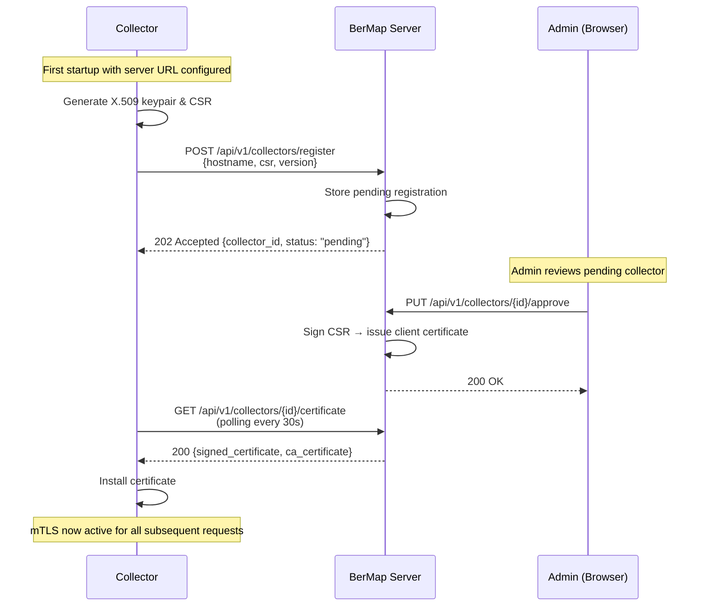
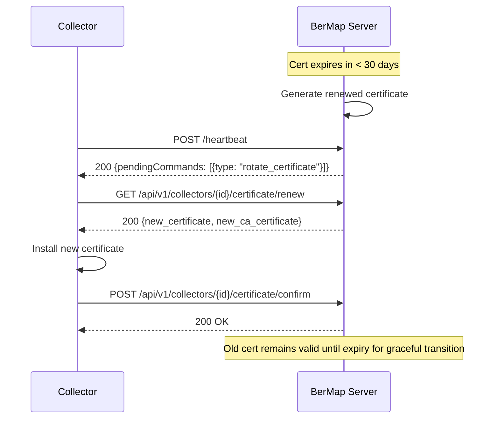

# 05 — Collector Communication Protocol

## 1. Overview

BerMap Collectors are lightweight .NET Worker Services deployed at remote sites or alongside infrastructure sources. They collect data from local systems and submit it to the central BerMap API Server using an **outbound-only HTTPS + mTLS** protocol.

### Design Principles

- **Outbound-Only** — Collectors always initiate connections. The server never calls collectors.
- **Offline-Resilient** — When the server is unreachable, data is queued locally in an encrypted SQLite database.
- **Secure by Default** — Mutual TLS (mTLS) authenticates both collector and server.
- **Idempotent Submission** — All data submissions are idempotent; duplicate submissions are safely ignored.

---

## 2. Registration Flow



### Registration Request

```json
POST /api/v1/collectors/register
Content-Type: application/json

{
  "hostname": "collector-site-a.corp.local",
  "os": "Windows Server 2022",
  "version": "1.0.0",
  "csr": "-----BEGIN CERTIFICATE REQUEST-----\n...\n-----END CERTIFICATE REQUEST-----",
  "capabilities": ["active_directory", "vmware_vcenter", "sql_server"]
}
```

### Registration Response

```json
HTTP/1.1 202 Accepted

{
  "collectorId": "a1b2c3d4-...",
  "status": "pending_approval",
  "pollIntervalSeconds": 30,
  "pollUrl": "/api/v1/collectors/a1b2c3d4-.../certificate"
}
```

---

## 3. Heartbeat Protocol

Once registered and approved, the collector sends periodic heartbeats to maintain its active status.

### Heartbeat Interval & Timeout

| Parameter | Default | Configurable |
|---|---|---|
| Heartbeat Interval | 60 seconds | Yes (`Collector:HeartbeatIntervalSeconds`) |
| Server Timeout Threshold | 5 minutes (5 missed heartbeats) | Yes |
| Status after Timeout | `inactive` | — |
| Status after 24h Timeout | `stale` | — |

### Heartbeat Request

```json
POST /api/v1/collectors/{collectorId}/heartbeat
X-Collector-Certificate: <mTLS authenticated>
Content-Type: application/json

{
  "status": "healthy",
  "uptimeSeconds": 86400,
  "cpuPercent": 12.5,
  "memoryMb": 512,
  "queueDepth": 0,
  "activeJobs": 2,
  "adapterStatuses": {
    "active_directory": "healthy",
    "vmware_vcenter": "healthy",
    "sql_server": "error"
  },
  "version": "1.0.0",
  "timestamp": "2025-01-15T10:30:00Z"
}
```

### Heartbeat Response

```json
HTTP/1.1 200 OK

{
  "acknowledged": true,
  "serverTime": "2025-01-15T10:30:01Z",
  "pendingCommands": [
    {
      "commandId": "cmd-123",
      "type": "start_discovery",
      "integrationId": "int-456",
      "parameters": {}
    }
  ]
}
```

> [!NOTE]
> The heartbeat response is the **only mechanism** for the server to send commands to a collector. This preserves the outbound-only design.

---

## 4. Data Submission Protocol

### 4.1 Batch Upload

Collectors submit discovered data in compressed batches:

```json
POST /api/v1/collectors/{collectorId}/data
X-Collector-Certificate: <mTLS authenticated>
Content-Type: application/json
Content-Encoding: gzip
X-Batch-Id: batch-789
X-Submission-Timestamp: 2025-01-15T10:35:00Z

{
  "batchId": "batch-789",
  "integrationId": "int-456",
  "discoveryJobId": "job-012",
  "submittedAt": "2025-01-15T10:35:00Z",
  "entities": [
    {
      "externalId": "vm-1234",
      "entityType": "virtual_machine",
      "name": "web-server-01",
      "fqdn": "web-server-01.corp.local",
      "metadata": {
        "cpu_count": 4,
        "memory_gb": 16,
        "os": "Windows Server 2022",
        "power_state": "on"
      }
    }
  ],
  "relationships": [
    {
      "sourceExternalId": "vm-1234",
      "targetExternalId": "host-5678",
      "relationshipType": "HOSTED_ON",
      "confidence": "verified",
      "evidence": "vCenter API vm.runtime.host"
    }
  ],
  "metrics": [
    {
      "entityExternalId": "vm-1234",
      "metricType": "cpu_percent",
      "value": 45.2,
      "collectedAt": "2025-01-15T10:30:00Z"
    }
  ]
}
```

### 4.2 Batch Size Limits

| Parameter | Default | Configurable |
|---|---|---|
| Max entities per batch | 500 | Yes |
| Max relationships per batch | 2,000 | Yes |
| Max metrics per batch | 5,000 | Yes |
| Max compressed payload size | 10 MB | Yes |
| Compression | gzip (required for payloads > 1 KB) | — |

### 4.3 Submission Response

```json
HTTP/1.1 200 OK

{
  "batchId": "batch-789",
  "accepted": true,
  "entitiesReceived": 1,
  "relationshipsReceived": 1,
  "metricsReceived": 1,
  "reconciliationResults": {
    "entitiesCreated": 0,
    "entitiesUpdated": 1,
    "entitiesSkipped": 0,
    "relationshipsCreated": 0,
    "relationshipsUpdated": 1,
    "conflicts": []
  }
}
```

---

## 5. mTLS Certificate Setup and Rotation

### 5.1 Certificate Hierarchy

```
BerMap Root CA (self-signed, generated during installation)
├── Server Certificate (CN=bermap-server.corp.local)
└── Collector Certificates
    ├── collector-site-a.corp.local
    ├── collector-site-b.corp.local
    └── ...
```

### 5.2 Certificate Lifecycle

| Stage | Actor | Action |
|---|---|---|
| **Root CA Generation** | Installer | Generate self-signed root CA (RSA 4096 / ECDSA P-384), validity 10 years |
| **Server Certificate** | Installer | Issue server cert from root CA, validity 2 years |
| **Collector CSR** | Collector | Generate keypair + CSR on first start |
| **Collector Cert Issuance** | Admin (via Server) | Approve registration → server signs CSR with root CA, validity 1 year |
| **Rotation** | Server | 30 days before expiry, server generates new cert; collector fetches on next heartbeat |
| **Revocation** | Admin | Revoke collector → add to local CRL; collector connections rejected |

### 5.3 Rotation Flow



---

## 6. Offline Queue

When the BerMap Server is unreachable, the collector queues all pending data locally.

### 6.1 Queue Implementation

| Aspect | Detail |
|---|---|
| Storage | SQLite database (`queue.db`) |
| Encryption | AES-256-GCM; key derived from collector certificate private key |
| Location | `%ProgramData%\BerMap\Collector\queue.db` (Windows) / `/var/lib/bermap/collector/queue.db` (Linux) |
| Schema | `queued_batches(id, batch_data, created_at, retry_count, last_retry_at)` |

### 6.2 Queue Configuration

| Parameter | Default | Description |
|---|---|---|
| `Collector:Queue:MaxSizeMb` | 500 | Maximum queue size in MB |
| `Collector:Queue:MaxRetentionHours` | 168 (7 days) | Maximum age of queued items before discard |
| `Collector:Queue:DiskQuotaPercent` | 10 | Maximum percentage of disk space to use |
| `Collector:Queue:MaxBatchRetries` | 10 | Maximum retry attempts per batch |

### 6.3 Queue Drain Behavior

When connectivity is restored:

1. Queue drain runs as a background task.
2. Batches are submitted in **FIFO order** (oldest first).
3. Each successful submission removes the batch from the queue.
4. Failed submissions increment `retry_count` and apply exponential backoff.
5. Batches exceeding `MaxBatchRetries` are moved to a dead-letter table and logged.

---

## 7. Retry Strategy

| Retry | Delay | Notes |
|---|---|---|
| 1 | 5 seconds | Immediate retry for transient failures |
| 2 | 15 seconds | |
| 3 | 30 seconds | |
| 4 | 1 minute | |
| 5 | 5 minutes | |
| 6 | 15 minutes | |
| 7 | 30 minutes | |
| 8 | 1 hour | |
| 9 | 2 hours | |
| 10 | 4 hours | Max retry; moved to dead letter after this |

**Jitter**: ±20% random jitter applied to all retry delays to prevent thundering herd.

---

## 8. Error Reporting

Collectors report errors through two channels:

### 8.1 Heartbeat Error Reporting

```json
{
  "status": "degraded",
  "errors": [
    {
      "code": "ADAPTER_CONNECTION_FAILED",
      "adapter": "vmware_vcenter",
      "message": "Connection refused: vcenter.corp.local:443",
      "occurredAt": "2025-01-15T10:25:00Z",
      "retryCount": 3
    }
  ]
}
```

### 8.2 Error Submission Endpoint

```json
POST /api/v1/collectors/{collectorId}/errors
{
  "errors": [
    {
      "errorId": "err-abc",
      "severity": "error",
      "category": "discovery",
      "integrationId": "int-456",
      "message": "Failed to enumerate VMs: Access denied",
      "stackTrace": "...",
      "occurredAt": "2025-01-15T10:25:00Z"
    }
  ]
}
```

---

## 9. Protocol Message Format Summary

| Endpoint | Method | Auth | Compression | Purpose |
|---|---|---|---|---|
| `/api/v1/collectors/register` | POST | None (initial) | No | Collector registration |
| `/api/v1/collectors/{id}/certificate` | GET | Polling token | No | Fetch signed certificate |
| `/api/v1/collectors/{id}/heartbeat` | POST | mTLS | No | Health status + receive commands |
| `/api/v1/collectors/{id}/data` | POST | mTLS | gzip | Submit discovered data |
| `/api/v1/collectors/{id}/errors` | POST | mTLS | No | Report errors |
| `/api/v1/collectors/{id}/certificate/renew` | GET | mTLS | No | Fetch renewed certificate |
| `/api/v1/collectors/{id}/certificate/confirm` | POST | mTLS | No | Confirm certificate rotation |

---

## 10. Security Considerations

| Concern | Mitigation |
|---|---|
| **Man-in-the-Middle** | mTLS ensures both parties are authenticated; TLS 1.2+ enforced |
| **Replay Attacks** | Batch IDs are unique; server rejects duplicate `batchId` submissions |
| **Collector Impersonation** | Certificate thumbprint bound to collector ID; mismatch rejects connection |
| **Queue Tampering** | SQLite queue encrypted with AES-256-GCM; key derived from collector private key |
| **Certificate Theft** | Private keys stored in OS certificate store (Windows) or file with `600` permissions (Linux) |
| **Unauthorized Discovery** | Collector can only submit data for integrations assigned to it by the server |
| **DoS via Queue Flood** | Disk quota and max size limits prevent unbounded queue growth |
