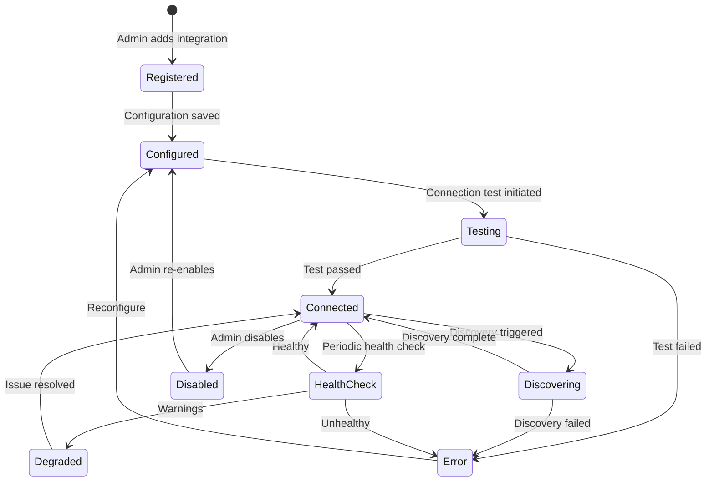
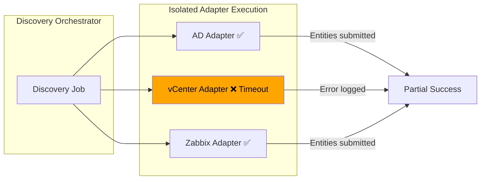

# 06 — Integration Adapter Design

## 1. Overview

Integration adapters are the data collection layer of BerMap. Each adapter encapsulates the logic to connect to a specific infrastructure source (e.g., VMware vCenter, Active Directory), discover entities and relationships, and translate them into BerMap's unified graph model.

### Design Goals

- **Pluggable** — New adapters are added without modifying core code.
- **Isolated** — A failure in one adapter never affects other adapters.
- **Testable** — Each adapter's connection can be verified before discovery.
- **Versioned** — Adapters declare their version; the system supports side-by-side versions during upgrades.
- **Self-Describing** — Adapters declare their capabilities and configuration schema.

---

## 2. Core Interfaces

### 2.1 IIntegrationAdapter

The primary interface every adapter must implement:

```csharp
/// <summary>
/// Core interface for all integration adapters.
/// Each adapter provides discovery and connection testing for a specific infrastructure source.
/// </summary>
public interface IIntegrationAdapter
{
    /// <summary>Unique adapter type identifier (e.g., "vmware_vcenter", "active_directory").</summary>
    string AdapterType { get; }

    /// <summary>Human-readable display name.</summary>
    string DisplayName { get; }

    /// <summary>Semantic version of this adapter.</summary>
    string Version { get; }

    /// <summary>Declared capabilities of this adapter.</summary>
    AdapterCapabilities Capabilities { get; }

    /// <summary>JSON Schema describing the required configuration parameters.</summary>
    ConfigurationSchema ConfigurationSchema { get; }

    /// <summary>Initialize the adapter with its configuration.</summary>
    Task InitializeAsync(AdapterConfiguration configuration, CancellationToken ct);

    /// <summary>Release resources held by the adapter.</summary>
    Task ShutdownAsync(CancellationToken ct);
}
```

### 2.2 IDiscoveryProvider

```csharp
/// <summary>
/// Discovers entities and relationships from an infrastructure source.
/// </summary>
public interface IDiscoveryProvider
{
    /// <summary>
    /// Execute a full or incremental discovery.
    /// Yields discovered items as an async stream for memory efficiency.
    /// </summary>
    IAsyncEnumerable<DiscoveryBatch> DiscoverAsync(
        DiscoveryContext context,
        CancellationToken ct);

    /// <summary>Supported entity types this adapter can discover.</summary>
    IReadOnlyList<string> SupportedEntityTypes { get; }

    /// <summary>Supported relationship types this adapter can discover.</summary>
    IReadOnlyList<string> SupportedRelationshipTypes { get; }
}
```

### 2.3 IConnectionTester

```csharp
/// <summary>
/// Tests connectivity and authentication to the infrastructure source.
/// </summary>
public interface IConnectionTester
{
    /// <summary>
    /// Test the connection with the given configuration.
    /// Returns a detailed result including latency and any warnings.
    /// </summary>
    Task<ConnectionTestResult> TestConnectionAsync(
        AdapterConfiguration configuration,
        CancellationToken ct);
}

public record ConnectionTestResult
{
    public bool IsSuccess { get; init; }
    public string Message { get; init; } = string.Empty;
    public TimeSpan Latency { get; init; }
    public string? ServerVersion { get; init; }
    public IReadOnlyList<string> Warnings { get; init; } = [];
    public string? ErrorCode { get; init; }
    public string? ErrorDetail { get; init; }
}
```

---

## 3. AdapterCapabilities

```csharp
/// <summary>
/// Declares what an adapter can do. Used by the UI and orchestration engine
/// to determine available actions.
/// </summary>
public record AdapterCapabilities
{
    /// <summary>Supports full discovery (enumerate all entities).</summary>
    public bool SupportsFullDiscovery { get; init; } = true;

    /// <summary>Supports incremental/delta discovery.</summary>
    public bool SupportsIncrementalDiscovery { get; init; } = false;

    /// <summary>Supports real-time event streaming.</summary>
    public bool SupportsEventStream { get; init; } = false;

    /// <summary>Supports capacity metric collection.</summary>
    public bool SupportsMetrics { get; init; } = false;

    /// <summary>Supports connection testing.</summary>
    public bool SupportsConnectionTest { get; init; } = true;

    /// <summary>Supports health check (lighter than full connection test).</summary>
    public bool SupportsHealthCheck { get; init; } = false;

    /// <summary>Maximum recommended concurrent instances.</summary>
    public int MaxConcurrency { get; init; } = 1;

    /// <summary>Estimated discovery duration for sizing UI feedback.</summary>
    public TimeSpan EstimatedDiscoveryDuration { get; init; } = TimeSpan.FromMinutes(5);
}
```

---

## 4. ConfigurationSchema

Each adapter declares a JSON Schema describing its configuration parameters. This schema is used by the Web Console to dynamically render configuration forms.

```csharp
public record ConfigurationSchema
{
    /// <summary>JSON Schema (draft 2020-12) describing the adapter's configuration.</summary>
    public string JsonSchema { get; init; } = "{}";

    /// <summary>List of fields that contain secrets (passwords, API keys) and must be encrypted.</summary>
    public IReadOnlyList<string> SecretFields { get; init; } = [];
}
```

**Example: vCenter Configuration Schema**

```json
{
  "$schema": "https://json-schema.org/draft/2020-12/schema",
  "type": "object",
  "required": ["host", "username", "password"],
  "properties": {
    "host": {
      "type": "string",
      "title": "vCenter Host",
      "description": "FQDN or IP of the vCenter Server",
      "examples": ["vcenter.corp.local"]
    },
    "port": {
      "type": "integer",
      "title": "Port",
      "default": 443
    },
    "username": {
      "type": "string",
      "title": "Username",
      "description": "Service account with read-only access"
    },
    "password": {
      "type": "string",
      "title": "Password",
      "format": "password"
    },
    "ignoreSslErrors": {
      "type": "boolean",
      "title": "Ignore SSL Certificate Errors",
      "default": false
    }
  }
}
```

---

## 5. Adapter Lifecycle



### Lifecycle Steps

| Step | Description |
|---|---|
| **Register** | Admin creates integration entry, selects adapter type |
| **Configure** | Admin fills in adapter-specific configuration (rendered from `ConfigurationSchema`) |
| **Test** | System calls `IConnectionTester.TestConnectionAsync` to verify connectivity |
| **Discover** | System calls `IDiscoveryProvider.DiscoverAsync` to collect entities/relationships |
| **Sync** | Scheduled periodic re-discovery (full or incremental) |
| **Health Check** | Periodic lightweight check that the source is still reachable |

---

## 6. Rate Limiting and Concurrency Control

| Control | Implementation |
|---|---|
| **Per-Adapter Concurrency** | `SemaphoreSlim` scoped to adapter type; limit from `AdapterCapabilities.MaxConcurrency` |
| **Per-Source Rate Limit** | Configurable requests-per-second per integration (default: 50 req/s) |
| **Global Discovery Concurrency** | Maximum 3 concurrent discovery jobs per tenant (configurable) |
| **API Call Throttling** | Adapters use `Polly` rate-limiter policies for outbound API calls |
| **Backpressure** | `IAsyncEnumerable` allows the consumer to control data flow speed |

---

## 7. Error Isolation



### Isolation Guarantees

1. Each adapter runs in its own `try/catch` boundary.
2. An adapter timeout (default: 30 minutes) kills the adapter's discovery without affecting others.
3. Adapter exceptions are caught, logged, and reported to the admin — they do not propagate to the orchestrator.
4. The discovery job completes with `partial_success` status if any adapter fails.
5. Circuit breaker (via `Polly`): after 3 consecutive failures, an adapter is suspended for 5 minutes.

---

## 8. Adapter Versioning

| Aspect | Strategy |
|---|---|
| Version Format | Semantic versioning (`MAJOR.MINOR.PATCH`) |
| Registration | Adapters self-register on startup via `IAdapterRegistry` |
| Side-by-Side | Multiple versions can be registered; the integration configuration specifies which version to use |
| Deprecation | Old versions marked as deprecated; admin notified to reconfigure |
| Breaking Changes | Major version bump; old integration configurations remain on old version until migrated |

---

## 9. Planned Adapters

| Adapter Type | Source System | Entity Types | Priority |
|---|---|---|---|
| `active_directory` | Microsoft Active Directory (LDAPS) | Domain, OU, Computer, User, Group, Domain Controller | Phase 3 |
| `vmware_vcenter` | VMware vCenter Server | Datacenter, Cluster, Hypervisor (ESXi), VM, Datastore, Resource Pool, Network | Phase 3 |
| `zabbix` | Zabbix Monitoring | Host, Host Group, Template, Trigger, Item | Phase 3 |
| `microsoft_sccm` | Microsoft SCCM/MECM | Device, Collection, Software, Application | Phase 6 |
| `sql_server` | Microsoft SQL Server | SQL Instance, Database, AG Group, AG Replica, Linked Server | Phase 6 |
| `windows_server` | Windows Server (WMI/WinRM) | Physical Server, Service, Installed Software, Network Adapter | Phase 6 |
| `network_snmp` | SNMP-capable Devices | Switch, Router, Firewall, Port, VLAN | Phase 6 |
| `dns` | DNS Server | DNS Zone, DNS Record | Phase 6 |
| `dhcp` | DHCP Server | Scope, Lease, Reservation | Phase 6 |
| `storage_netapp` | NetApp ONTAP | Storage System, Volume, Aggregate, LIF | Future |
| `storage_pure` | Pure Storage | Array, Volume, Host Group | Future |
| `kubernetes` | Kubernetes API | Cluster, Namespace, Deployment, Pod, Service, Node | Future |

---

## 10. Discovery Data Model (DTOs)

```csharp
/// <summary>A batch of discovered entities, relationships, and metrics.</summary>
public record DiscoveryBatch
{
    public IReadOnlyList<DiscoveredEntity> Entities { get; init; } = [];
    public IReadOnlyList<DiscoveredRelationship> Relationships { get; init; } = [];
    public IReadOnlyList<DiscoveredMetric> Metrics { get; init; } = [];
}

public record DiscoveredEntity
{
    public required string ExternalId { get; init; }
    public required string EntityType { get; init; }
    public required string Name { get; init; }
    public string? Fqdn { get; init; }
    public string? DisplayName { get; init; }
    public Dictionary<string, object> Metadata { get; init; } = new();
}

public record DiscoveredRelationship
{
    public required string SourceExternalId { get; init; }
    public required string TargetExternalId { get; init; }
    public required string RelationshipType { get; init; }
    public string Confidence { get; init; } = "observed";
    public string? Evidence { get; init; }
    public Dictionary<string, object> Metadata { get; init; } = new();
}

public record DiscoveredMetric
{
    public required string EntityExternalId { get; init; }
    public required string MetricType { get; init; }
    public required decimal Value { get; init; }
    public DateTimeOffset CollectedAt { get; init; } = DateTimeOffset.UtcNow;
}
```
