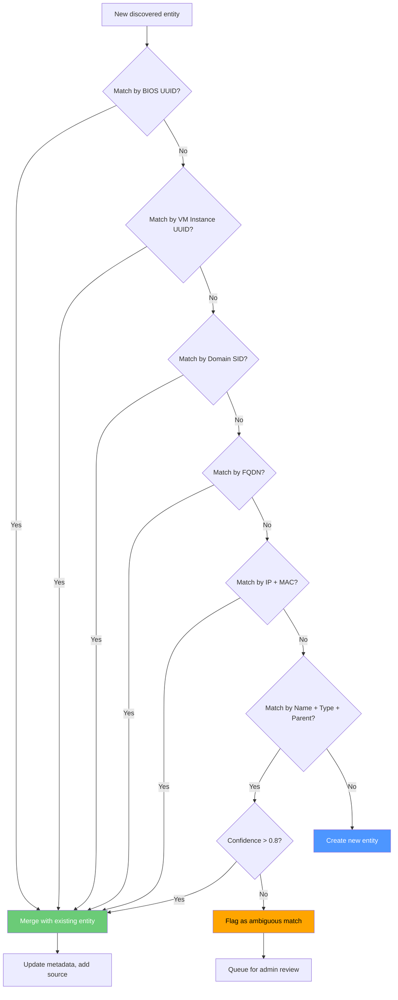

# 07 — Graph Data Model

## 1. Overview

BerMap models infrastructure as a **typed property graph** stored in PostgreSQL. The graph consists of **nodes** (entities representing infrastructure components) and **edges** (relationships representing dependencies, hosting, connectivity, and membership).

This is not a dedicated graph database — BerMap uses PostgreSQL's relational model with recursive CTEs for graph traversal, augmented with JSONB for flexible property storage.

---

## 2. Node Types

| Entity Type | Code | Description | Example |
|---|---|---|---|
| **Datacenter** | `datacenter` | Physical or logical datacenter facility | "Istanbul DC-1" |
| **Site** | `site` | Geographic location or campus | "Headquarters" |
| **Cluster** | `cluster` | Compute cluster (vSphere, Hyper-V, K8s) | "Prod Cluster A" |
| **Hypervisor** | `hypervisor` | Physical host running a hypervisor (ESXi, Hyper-V) | "esxi-host-01" |
| **Virtual Machine** | `virtual_machine` | Guest VM | "web-server-01" |
| **Physical Server** | `physical_server` | Bare-metal server (no hypervisor role) | "db-server-01" |
| **Operating System** | `operating_system` | OS instance running on a host/VM | "Windows Server 2022" |
| **Application** | `application` | Business application or service executable | "SAP ERP" |
| **Service** | `service` | Windows/Linux service or daemon | "IIS W3SVC" |
| **Database** | `database` | Database instance or named database | "OrdersDB (SQL Server)" |
| **Domain Controller** | `domain_controller` | Active Directory domain controller | "dc01.corp.local" |
| **Storage** | `storage` | Storage system, datastore, LUN, or volume | "NetApp Vol-01" |
| **Network Device** | `network_device` | Switch, router, firewall, load balancer | "core-switch-01" |
| **Network** | `network` | VLAN, subnet, or network segment | "10.0.1.0/24 (VLAN 100)" |
| **Endpoint** | `endpoint` | IP address, FQDN, or port endpoint | "10.0.1.50:443" |
| **Resource Pool** | `resource_pool` | vSphere Resource Pool or equivalent | "Prod Pool" |

---

## 3. Relationship Types

| Relationship Type | Direction | Description | Example |
|---|---|---|---|
| `HOSTED_ON` | Source → Target | Source is hosted on/runs on Target | VM → Hypervisor |
| `CONNECTED_TO` | Bidirectional | Network connectivity between entities | Switch → Switch |
| `DEPENDS_ON` | Source → Target | Source depends on Target for operation | App → Database |
| `MEMBER_OF` | Source → Target | Source is a member of Target group/cluster | Hypervisor → Cluster |
| `RUNS_ON` | Source → Target | Source application/service runs on Target OS/host | Service → VM |
| `USES_DATABASE` | Source → Target | Source application uses Target database | App → Database |
| `REPLICATES_TO` | Source → Target | Source replicates data to Target | DB → DB (AG Replica) |
| `MANAGED_BY` | Source → Target | Source is managed/monitored by Target | VM → vCenter |
| `CONNECTS_THROUGH` | Source → Target | Source reaches Target through intermediary | App → Load Balancer |
| `PROTECTED_BY` | Source → Target | Source is protected by Target (firewall, backup) | Network → Firewall |

---

## 4. Relationship Metadata Schema

Every relationship edge stores structured metadata:

```json
{
  "source_entity_id": "uuid",
  "target_entity_id": "uuid",
  "relationship_type": "HOSTED_ON",
  "discovery_source": "vmware_vcenter",
  "confidence": "verified",
  "evidence": "vCenter API vm.runtime.host property",
  "first_seen_at": "2025-01-10T08:00:00Z",
  "last_seen_at": "2025-01-15T10:30:00Z",
  "validation_status": "auto",
  "snapshot_version": 42,
  "metadata": {
    "port": 443,
    "protocol": "HTTPS",
    "bandwidth_mbps": 1000
  }
}
```

---

## 5. Relationship Confidence Levels

| Level | Code | Description | Typical Source |
|---|---|---|---|
| **Verified** | `verified` | Confirmed by authoritative source API (e.g., vCenter reports VM-to-Host mapping) | vCenter, AD, SQL Server metadata |
| **Observed** | `observed` | Detected through monitoring or network analysis but not confirmed by source | Zabbix dependencies, network flow analysis |
| **Inferred** | `inferred` | Algorithmically derived from naming conventions, IP proximity, or pattern matching | Name-based matching, subnet analysis, port scanning |

### Confidence Upgrade Rules

- An `inferred` relationship is upgraded to `observed` when a monitoring source confirms activity.
- An `observed` relationship is upgraded to `verified` when an authoritative source confirms the connection.
- An admin can manually set confidence to `verified` via the UI (`validation_status: manual_confirmed`).

---

## 6. Entity Reconciliation Strategy

When multiple adapters discover what may be the same entity, BerMap must reconcile them into a single graph node.

### 6.1 Matching Rules (Priority Order)

| Priority | Match Key | Applicable Types | Example |
|---|---|---|---|
| 1 | **BIOS UUID** | VM, Physical Server | vCenter `vm.config.uuid` = SCCM BIOS serial |
| 2 | **VM Instance UUID** | VM | vCenter `vm.config.instanceUuid` |
| 3 | **Domain SID** | Computer, Domain Controller | AD `objectSid` = WMI machine SID |
| 4 | **FQDN (normalized)** | All with DNS name | Lowercase, trailing dot stripped |
| 5 | **IP Address + MAC** | Network-connected entities | Same IP and MAC across sources |
| 6 | **Name + Type + Parent** | Cluster, Resource Pool | Same name within same parent entity |

### 6.2 Reconciliation Algorithm



### 6.3 Ambiguous Match Handling

When a potential match is found but confidence is below the threshold (0.8):

1. Both entities are kept as separate nodes.
2. A `POSSIBLE_DUPLICATE` relationship is created between them.
3. An admin notification is raised for manual review.
4. The admin can **merge** (combine into one) or **dismiss** (mark as separate entities).
5. Dismissed matches are recorded to prevent re-flagging.

---

## 7. Graph Traversal with Recursive CTEs

### 7.1 Downstream Impact Query

Find all entities affected if a given entity fails (traverse `DEPENDS_ON`, `HOSTED_ON`, `RUNS_ON`):

```sql
WITH RECURSIVE impact_chain AS (
    -- Seed: the failing entity
    SELECT
        e.id AS entity_id,
        e.name,
        e.entity_type,
        0 AS depth,
        ARRAY[e.id] AS path
    FROM entities e
    WHERE e.id = :failing_entity_id
      AND e.tenant_id = :tenant_id
      AND NOT e.is_deleted

    UNION ALL

    -- Recurse: find entities that depend on / are hosted on the current level
    SELECT
        e2.id,
        e2.name,
        e2.entity_type,
        ic.depth + 1,
        ic.path || e2.id
    FROM impact_chain ic
    JOIN relationships r ON (
        r.target_entity_id = ic.entity_id
        AND r.relationship_type IN ('DEPENDS_ON', 'HOSTED_ON', 'RUNS_ON', 'USES_DATABASE')
        AND NOT r.is_deleted
    )
    JOIN entities e2 ON (
        e2.id = r.source_entity_id
        AND NOT e2.is_deleted
    )
    WHERE e2.id != ALL(ic.path)  -- cycle prevention
      AND ic.depth < 10          -- max depth guard
)
SELECT DISTINCT ON (entity_id)
    entity_id,
    name,
    entity_type,
    depth,
    path
FROM impact_chain
ORDER BY entity_id, depth;
```

### 7.2 Upstream Dependency Query

Find all entities that a given entity depends on:

```sql
WITH RECURSIVE dependency_chain AS (
    SELECT
        e.id AS entity_id,
        e.name,
        e.entity_type,
        0 AS depth,
        ARRAY[e.id] AS path
    FROM entities e
    WHERE e.id = :entity_id
      AND e.tenant_id = :tenant_id
      AND NOT e.is_deleted

    UNION ALL

    SELECT
        e2.id,
        e2.name,
        e2.entity_type,
        dc.depth + 1,
        dc.path || e2.id
    FROM dependency_chain dc
    JOIN relationships r ON (
        r.source_entity_id = dc.entity_id
        AND r.relationship_type IN ('DEPENDS_ON', 'HOSTED_ON', 'RUNS_ON', 'USES_DATABASE')
        AND NOT r.is_deleted
    )
    JOIN entities e2 ON (
        e2.id = r.target_entity_id
        AND NOT e2.is_deleted
    )
    WHERE e2.id != ALL(dc.path)
      AND dc.depth < 10
)
SELECT DISTINCT ON (entity_id)
    entity_id,
    name,
    entity_type,
    depth,
    path
FROM dependency_chain
ORDER BY entity_id, depth;
```

---

## 8. Performance Indexing Strategy for 30K+ Nodes

### Index Design

| Index | Purpose | Expected Improvement |
|---|---|---|
| `idx_relationships_source` | Forward traversal (source → targets) | 10x faster downstream queries |
| `idx_relationships_target` | Reverse traversal (target → sources) | 10x faster upstream queries |
| `idx_entities_tenant_type` | Filter by type within tenant | Speeds up type-specific listings |
| `idx_entities_fqdn` | Reconciliation lookups | Sub-ms FQDN matching |
| `idx_relationships_metadata` (GIN) | JSONB property queries | Enables metadata-filtered traversals |
| `idx_entities_metadata` (GIN) | JSONB property queries on entities | Metadata search across all entities |

### Performance Targets

| Metric | Target | Approach |
|---|---|---|
| 5-hop traversal (30K nodes) | < 2 seconds | Recursive CTE with depth limit + indexed edges |
| Full graph export | < 30 seconds | Streaming query with server-side cursor |
| Entity search by name/FQDN | < 100 ms | B-tree index on `name`, `fqdn` |
| Metadata property query | < 500 ms | GIN index on `metadata` JSONB |
| Reconciliation match | < 200 ms per entity | Composite index on match keys |

### PostgreSQL Configuration Recommendations

```ini
# postgresql.conf tuning for graph workloads
work_mem = 256MB                    # CTE materialization
effective_cache_size = 8GB          # Planner hint
random_page_cost = 1.1              # SSD storage
max_parallel_workers_per_gather = 4 # Parallel seq scans
recursive_worktable_factor = 10.0   # Better CTE planning (PG 15+)
```
