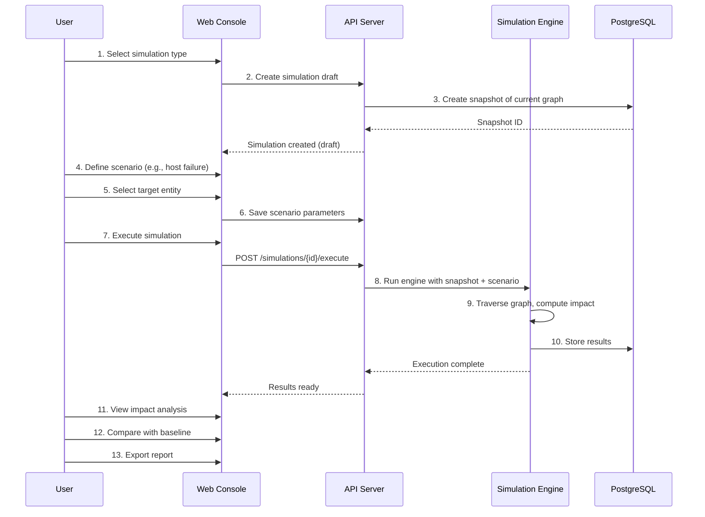
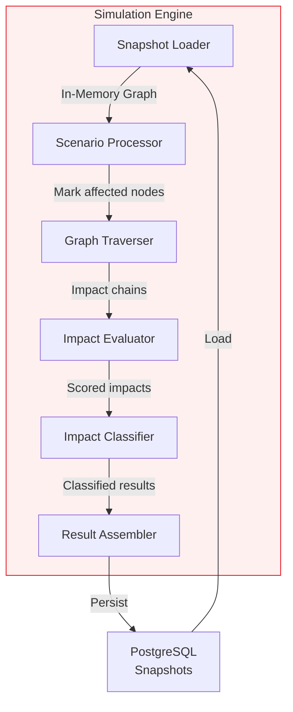
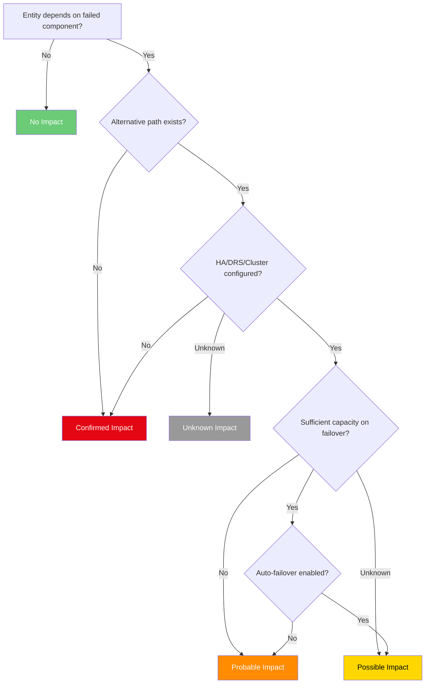
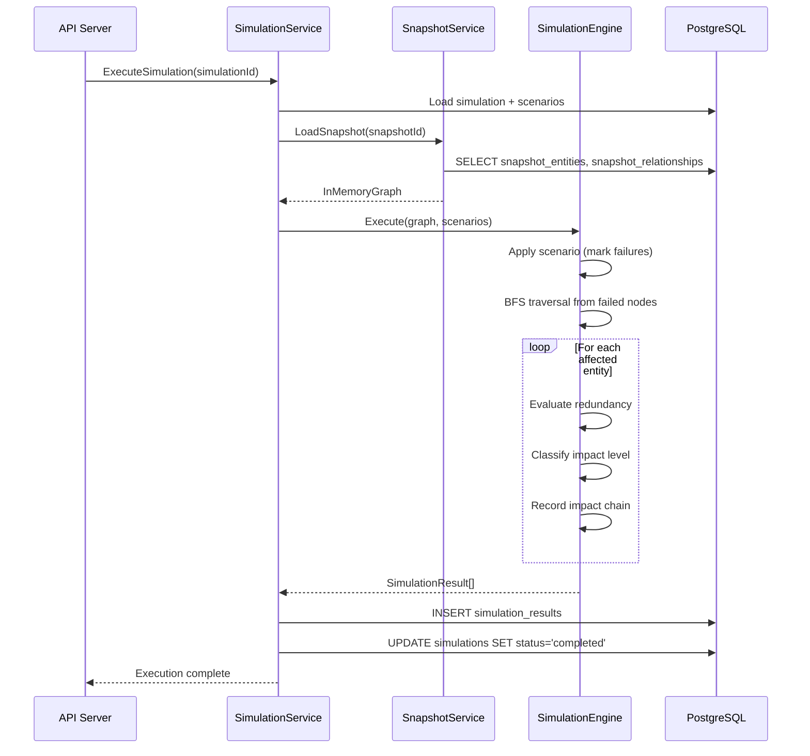

# 08 — Simulation Engine (BerSim)

> **"Simulate Before You Change"**

---

## 1. Overview

The BerSim Simulation Engine is BerMap's what-if simulation capability. It enables infrastructure teams to model **what-if scenarios** against a frozen snapshot of the dependency graph and compute deterministic impact analysis — before any real change is made.

### Key Properties

| Property | Description |
|---|---|
| **Snapshot-Based** | Simulations operate on an immutable point-in-time copy of the graph, not live data |
| **Deterministic** | Given the same snapshot + scenario, the engine always produces the same result |
| **AI-Independent** | The core engine is purely algorithmic; AI is an optional interpretation layer |
| **Auditable** | Every simulation run is logged with inputs, parameters, and results |

---

## 2. Simulation Workflow

### Workflow Steps

| Step | Action | Description |
|---|---|---|
| 1 | **Select Type** | User chooses a simulation scenario type from the catalog |
| 2 | **Create Draft** | System creates a simulation record in `draft` status |
| 3 | **Snapshot Graph** | System freezes the current graph state into a snapshot |
| 4 | **Define Scenario** | User specifies the what-if condition (e.g., "ESXi host fails") |
| 5 | **Select Targets** | User selects the entity/entities affected by the scenario |
| 6 | **Save Parameters** | Scenario parameters persisted (can be modified before execution) |
| 7 | **Execute** | User triggers simulation execution |
| 8 | **Run Engine** | Engine loads snapshot, applies scenario, traverses graph |
| 9 | **Compute Impact** | Deterministic graph traversal identifies all affected entities |
| 10 | **Store Results** | Results persisted to `simulation_results` table |
| 11 | **View Results** | User reviews impact analysis with visual graph highlights |
| 12 | **Compare** | User compares results against baseline or prior simulations |
| 13 | **Export** | User exports results as PDF/Excel report |

---

## 3. Supported Scenario Types

| Scenario Type | Code | Description | Parameters |
|---|---|---|---|
| **Host Failure** | `host_failure` | Simulate a physical host or hypervisor going down | `entityId` |
| **Planned Maintenance** | `maintenance` | Simulate taking a host offline for maintenance | `entityId`, `maintenanceDurationMinutes` |
| **VM Migration** | `vm_migration` | Simulate migrating a VM to a different host | `vmId`, `sourceHostId`, `targetHostId` |
| **Datastore Failure** | `datastore_failure` | Simulate a storage volume or datastore becoming unavailable | `entityId` |
| **Network Failure** | `network_failure` | Simulate a network segment or device failure | `entityId` (network or switch) |
| **Datacenter Failure** | `dc_failure` | Simulate an entire datacenter going offline | `entityId` (datacenter) |
| **SQL Server Failure** | `sql_failure` | Simulate a SQL Server instance failing | `entityId` (database) |
| **Application Failure** | `app_failure` | Simulate an application stopping | `entityId` (application) |
| **Capacity Reduction** | `capacity_reduction` | Simulate reducing resources (CPU, memory, storage) | `entityId`, `resourceType`, `reductionPercent` |
| **Utilization Increase** | `utilization_increase` | Simulate sudden workload increase | `entityId`, `resourceType`, `increasePercent` |
| **Expansion Planning** | `expansion` | Simulate adding new resources to evaluate capacity | `parentEntityId`, `newResourceSpec` |

---

## 4. Engine Design

### 4.1 Architecture

### 4.2 Execution Pipeline

1. **Snapshot Loader** — Loads the snapshot's entities and relationships into an in-memory graph structure optimized for traversal.
2. **Scenario Processor** — Applies the scenario to the in-memory graph (marks target entities as `failed`, adjusts capacity, simulates migrations).
3. **Graph Traverser** — Walks the graph from affected nodes using BFS/DFS to identify all reachable dependent entities.
4. **Impact Evaluator** — For each affected entity, evaluates redundancy (HA, DRS, clustering) and determines actual impact.
5. **Impact Classifier** — Assigns an impact level (confirmed/probable/possible/unknown) based on evaluation results.
6. **Result Assembler** — Collects all impact data, computes summary statistics, and persists results.

---

## 5. Impact Classification

| Level | Code | Description | Criteria |
|---|---|---|---|
| **Confirmed** | `confirmed` | Definite impact — no redundancy or failover available | Entity directly depends on the failed component with no alternative path |
| **Probable** | `probable` | Highly likely impact — redundancy exists but may not handle full load | HA exists but capacity is insufficient, or failover is manual |
| **Possible** | `possible` | May be impacted — depends on configuration or runtime conditions | Redundancy exists and appears sufficient, but confidence is < 1.0 |
| **Unknown** | `unknown` | Insufficient data to determine impact | Relationship confidence is `inferred`, or metadata is incomplete |

### Classification Decision Tree

---

## 6. HA/DRS/Cluster Redundancy Evaluation

The engine evaluates redundancy based on discovered metadata:

| Check | Data Source | Evaluation |
|---|---|---|
| **vSphere HA** | vCenter adapter: `cluster.ha_enabled`, `cluster.ha_admission_control` | If HA enabled + admission control active → failover probable |
| **vSphere DRS** | vCenter adapter: `cluster.drs_enabled`, `cluster.drs_automation_level` | Fully automated DRS → VMs will migrate; manual → PROBABLE impact |
| **SQL AG** | SQL adapter: `ag.availability_mode`, `ag.failover_mode` | Synchronous + automatic → failover likely; async → data loss risk |
| **AD Replication** | AD adapter: `domain.dc_count`, `site.dc_count` | Multiple DCs in site → failover; single DC → CONFIRMED |
| **Network Redundancy** | Network adapter: `device.redundancy_group`, bonding info | Bonded interfaces → possible failover; single link → CONFIRMED |

---

## 7. Incomplete Data Handling

When the engine encounters incomplete data during simulation:

| Scenario | Behavior |
|---|---|
| **Missing HA metadata** | Assume no HA → classify as `confirmed` with note "HA status unknown" |
| **Inferred relationship** | Include in results with `unknown` impact level + flag for review |
| **Missing capacity data** | Cannot evaluate capacity-based scenarios → classify as `unknown` |
| **Orphan entities** | Entities with no relationships are excluded from impact (logged as warning) |
| **Circular dependencies** | Cycle detection prevents infinite loops; circular deps flagged in results |

> [!IMPORTANT]
> The engine is **conservative by default** — when in doubt, it assumes the worst case and flags the result for human review.

---

## 8. Simulation Storage and Comparison

### Storage

- Each simulation run is fully persisted: snapshot, scenarios, and results.
- Results include the full impact chain (ordered list of entity IDs from root cause to affected entity).
- Simulations are immutable after completion — re-running creates a new simulation.

### Comparison

Users can compare two simulations to see:

| Comparison | Description |
|---|---|
| **Baseline vs. Current** | Compare impact of the same scenario on different graph snapshots (e.g., before/after a change) |
| **Scenario A vs. B** | Compare impact of different scenarios on the same snapshot (e.g., "which host failure is worse?") |
| **Diff View** | Entities that moved between impact levels, new impacts, resolved impacts |

---

## 9. AI as Optional Interpretation Layer

> [!CAUTION]
> AI **never replaces** the deterministic simulation engine. AI is an optional presentation and analysis layer.

| AI Role | What It Does | What It Does NOT Do |
|---|---|---|
| **Result Summary** | Generate natural language summary of simulation results | Generate simulation results |
| **Risk Narration** | Explain impact chains in business terms | Override impact classifications |
| **Recommendation** | Suggest mitigation actions (e.g., "consider adding HA") | Execute remediation |
| **Pattern Recognition** | Identify recurring single points of failure | Alter the graph model |

When AI is not available (e.g., no AI model configured), the platform is fully functional — all results are presented through structured tables and visual graphs.

---

## 10. Simulation Execution Sequence

