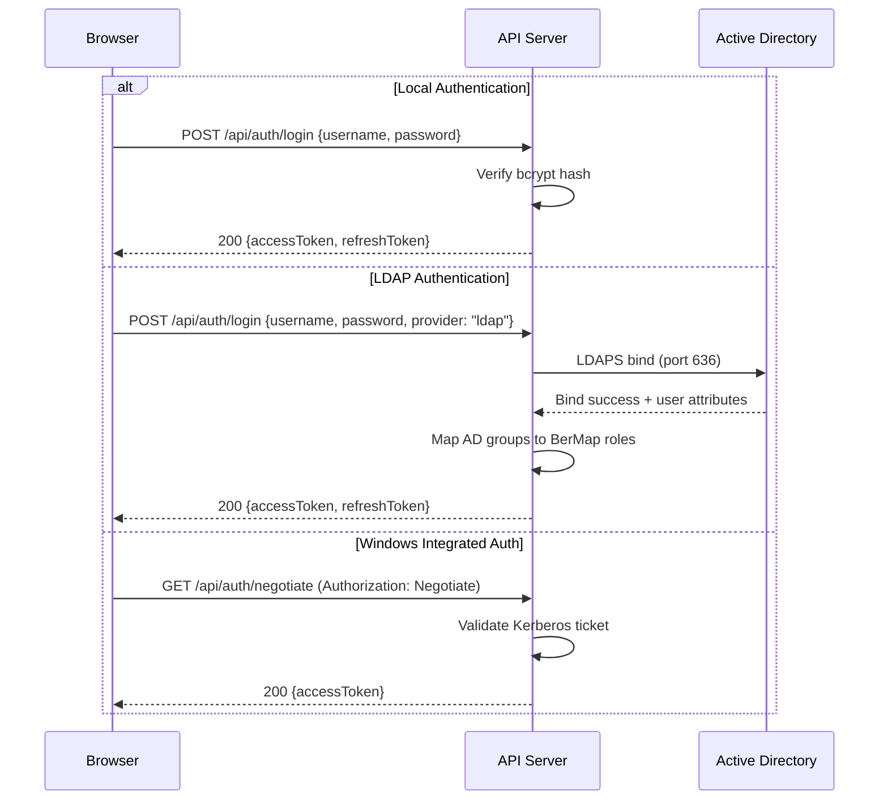

# 09 — Security Architecture

## 1. Security Design Principles

| Principle | Implementation |
|---|---|
| **Defense in Depth** | Multiple security layers: network (TLS), transport (mTLS), application (RBAC), data (encryption at rest) |
| **Least Privilege** | Every user, collector, and service account gets the minimum permissions required |
| **Zero Trust for Collectors** | Collectors are authenticated via mTLS; authorization is scoped to assigned integrations only |
| **Audit Everything** | All state-changing operations are logged with actor, action, timestamp, resource, and outcome |
| **Fail Secure** | Authentication/authorization failures result in denial; never fail-open |
| **Offline-First Security** | All security mechanisms work without internet access — no external auth providers, no OCSP |

---

## 2. Authentication

### 2.1 Authentication Providers

| Provider | Method | Use Case |
|---|---|---|
| **Local** | Username + bcrypt-hashed password | Default; always available |
| **Active Directory (LDAPS)** | LDAP bind over TLS (port 636) | Enterprise environments with AD |
| **Windows Integrated Auth** | Kerberos / NTLM (via `Negotiate`) | Seamless SSO on domain-joined browsers |

### 2.2 Authentication Flow



### 2.3 Token Management

| Aspect | Configuration |
|---|---|
| Access Token | JWT; 30-minute lifetime; signed with HMAC-SHA256 or RSA |
| Refresh Token | Opaque token stored in DB; 7-day lifetime; single-use (rotate on refresh) |
| Token Storage (Client) | `httpOnly`, `Secure`, `SameSite=Strict` cookie for access token |
| Token Revocation | Refresh tokens can be revoked; access tokens expire naturally |

---

## 3. Authorization — RBAC

### 3.1 System Roles

| Role | Code | Description |
|---|---|---|
| **Platform Admin** | `platform_admin` | Full system access; user management, system configuration, all modules |
| **Integration Admin** | `integration_admin` | Manage integrations, collectors, credentials; run discovery |
| **Infrastructure Operator** | `infra_operator` | View topology, run simulations, view impact analysis, capacity planning |
| **Security Auditor** | `security_auditor` | Read-only access to audit logs, user activity, security events |
| **Read-Only Viewer** | `viewer` | Read-only access to dashboards, topology, reports |

### 3.2 Permission Model

| Resource | `platform_admin` | `integration_admin` | `infra_operator` | `security_auditor` | `viewer` |
|---|---|---|---|---|---|
| **Users & Roles** | CRUD | — | — | Read | — |
| **System Config** | CRUD | — | — | Read | — |
| **Integrations** | CRUD | CRUD | Read | Read | Read |
| **Collectors** | CRUD | CRUD | Read | Read | Read |
| **Credentials** | CRUD | CRUD | — | — | — |
| **Entities** | CRUD | Read | Read | Read | Read |
| **Relationships** | CRUD | Read | Read | Read | Read |
| **Topology View** | Read | Read | Read | Read | Read |
| **Simulations** | CRUD | — | CRUD | Read | Read |
| **Impact Analysis** | Read | Read | Read | Read | Read |
| **Capacity** | Read | Read | Read | Read | Read |
| **Reports** | CRUD | Read | CRUD | Read | Read |
| **Audit Logs** | Read | — | — | Read | — |
| **Discovery Jobs** | CRUD | CRUD | Read | Read | Read |
| **Events** | Read | Read | Read | Read | Read |

*CRUD = Create, Read, Update, Delete*

### 3.3 Authorization Enforcement

```
HTTP Request
  → Authentication Middleware (validate JWT / Negotiate)
    → Authorization Middleware (check role + resource + action)
      → Controller / Endpoint
        → Application Service (may perform fine-grained checks)
```

Authorization is enforced via ASP.NET Core `[Authorize]` attributes and custom `IAuthorizationHandler` implementations.

---

## 4. Transport Security

### 4.1 TLS Configuration

| Aspect | Requirement |
|---|---|
| **Minimum TLS Version** | TLS 1.2 |
| **Preferred TLS Version** | TLS 1.3 |
| **Cipher Suites (TLS 1.2)** | `TLS_ECDHE_RSA_WITH_AES_256_GCM_SHA384`, `TLS_ECDHE_RSA_WITH_AES_128_GCM_SHA256` |
| **Cipher Suites (TLS 1.3)** | `TLS_AES_256_GCM_SHA384`, `TLS_CHACHA20_POLY1305_SHA256`, `TLS_AES_128_GCM_SHA256` |
| **Certificate Key Size** | RSA 2048+ or ECDSA P-256+ |
| **HSTS** | Enabled; `max-age=31536000; includeSubDomains` |

### 4.2 Collector mTLS

See [05-collector-protocol.md](05-collector-protocol.md) for detailed mTLS setup.

| Aspect | Detail |
|---|---|
| Client Certificate Required | Yes — collectors must present a valid certificate signed by the BerMap CA |
| Server Certificate Validation | Collectors validate the server certificate against the BerMap CA |
| Certificate Pinning | Certificate thumbprint is bound to collector ID; mismatch = rejection |
| CRL | Local Certificate Revocation List maintained by the server |

---

## 5. Credential Storage

### 5.1 Windows (Primary)

| Aspect | Implementation |
|---|---|
| Encryption | DPAPI (Data Protection API) with machine-scope key |
| Storage | Encrypted in PostgreSQL `credentials` table (`encrypted_data bytea`) |
| Key Management | Managed by Windows; backed by the machine's master key |
| Access Control | Only the `BerMapServer` service account can decrypt |

### 5.2 Linux (Secondary)

| Aspect | Implementation |
|---|---|
| Encryption | AES-256-GCM with key from a protected key file |
| Key File | `/etc/bermap/server/keys/master.key` with `600` permissions, owned by `bermap` user |
| Storage | Encrypted in PostgreSQL `credentials` table |
| Key Rotation | New key file → re-encrypt all credentials → old key file securely deleted |

### 5.3 Secret Rotation and Recovery

| Scenario | Procedure |
|---|---|
| **Credential Rotation** | Admin updates credential via UI → old encrypted data overwritten → connection test required |
| **Master Key Rotation** | Admin triggers via CLI → all credentials re-encrypted with new key → old key zeroed |
| **Recovery (Windows)** | Restore machine DPAPI keys from backup → credentials remain decryptable |
| **Recovery (Linux)** | Restore `master.key` from backup → credentials remain decryptable |
| **Key Loss** | All encrypted credentials are unrecoverable; must be re-entered manually |

---

## 6. Session Management

| Aspect | Implementation |
|---|---|
| Session Storage | Stateless JWT (access token) + server-side refresh token |
| Concurrent Sessions | Configurable max per user (default: 5) |
| Idle Timeout | 30 minutes (configurable) |
| Absolute Timeout | 12 hours (configurable) |
| Session Termination | Admin can force-terminate any user session |
| Session Events | Login, logout, token refresh, force-terminate all logged to audit |

---

## 7. CSRF Protection

| Aspect | Implementation |
|---|---|
| Mechanism | Anti-forgery token (ASP.NET Core `[ValidateAntiForgeryToken]`) for cookie-based auth |
| SPA Approach | `X-XSRF-TOKEN` header; token sent in non-httpOnly cookie, submitted in header |
| `SameSite` Cookie | `Strict` — prevents cross-origin cookie submission |

---

## 8. Input Validation

| Layer | Validation |
|---|---|
| **Client** | React form validation (immediate feedback only; not security boundary) |
| **API** | FluentValidation on all DTOs; max lengths, format checks, allowed values |
| **Database** | PostgreSQL constraints (NOT NULL, CHECK, UNIQUE) as final safety net |
| **JSONB** | Validated against JSON Schema before storage where applicable |
| **File Uploads** | Allowed extensions whitelist; max size 50 MB; virus-scanned if available |
| **SQL Injection** | Parameterized queries exclusively via EF Core; no raw SQL string concatenation |
| **XSS** | React auto-escapes; CSP headers; `dangerouslySetInnerHTML` prohibited |

---

## 9. API Rate Limiting

| Scope | Limit | Window |
|---|---|---|
| **Per-User** | 1,000 requests | 1 minute |
| **Per-IP (unauthenticated)** | 60 requests | 1 minute |
| **Login Endpoint** | 10 attempts | 1 minute |
| **Collector Data Submission** | 100 requests | 1 minute (per collector) |
| **Report Export** | 10 requests | 5 minutes |

Rate limiting is implemented via ASP.NET Core's built-in `RateLimiter` middleware with sliding window counters.

---

## 10. Audit Logging

Every state-changing operation is recorded:

| Field | Description | Example |
|---|---|---|
| `user_id` | Who performed the action | `uuid` |
| `username` | Username (denormalized for query efficiency) | `"admin"` |
| `action` | What was done | `"entity.create"` |
| `resource_type` | Type of resource affected | `"entity"` |
| `resource_id` | ID of the resource affected | `uuid` |
| `details` | JSONB with before/after state or parameters | `{"name": "web-01", "type": "vm"}` |
| `ip_address` | Client IP address | `10.0.1.50` |
| `user_agent` | Browser/client user agent | `"Mozilla/5.0..."` |
| `outcome` | Result of the action | `"success"` / `"failure"` / `"denied"` |
| `created_at` | Timestamp (UTC) | `2025-01-15T10:30:00Z` |

### Audit Log Retention

- Default: **2 years** (configurable).
- Audit logs are append-only; they cannot be modified or deleted through the application.
- Deletion only via database maintenance (admin privilege + documented procedure).

---

## 11. Security Checklist

| Category | Control | Status |
|---|---|---|
| Authentication | Multi-provider (Local, LDAP, Windows) | ✅ Designed |
| Authorization | Role-based with per-resource permissions | ✅ Designed |
| Transport | TLS 1.2+ for all connections | ✅ Designed |
| Collector Auth | Mutual TLS with certificate pinning | ✅ Designed |
| Credential Storage | DPAPI / AES-256-GCM encrypted | ✅ Designed |
| Input Validation | Multi-layer (client, API, DB) | ✅ Designed |
| CSRF | Anti-forgery tokens + SameSite cookies | ✅ Designed |
| Rate Limiting | Per-user and per-IP limits | ✅ Designed |
| Audit Logging | Full who/what/when/where/outcome | ✅ Designed |
| Session Management | JWT + refresh token with timeouts | ✅ Designed |
| Least Privilege | Scoped roles, scoped collector certificates | ✅ Designed |
