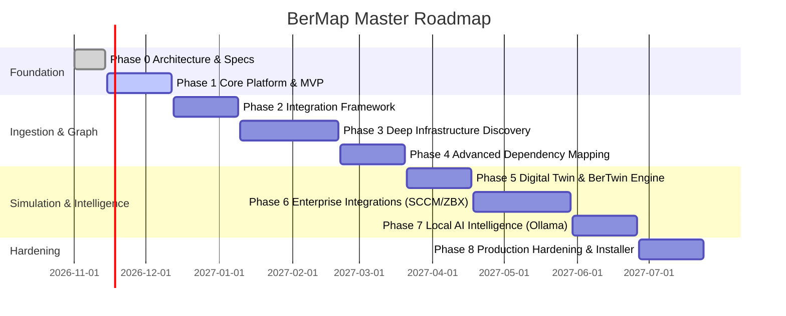

# 12 — Sprint-Based Development Plan

> **BerMap — Enterprise Infrastructure Intelligence & Digital Twin Platform**  
> *"Discover. Map. Analyze. Simulate. Predict."*

---

## 1. Development Methodology & Milestones

BerMap follows a strict **modular milestone delivery cycle** organized into 2-week sprints. Every sprint must culminate in a demonstrably functional, offline-verifiable build with automated unit and integration tests passing.

---

## 2. Phase & Sprint Breakdown

### Phase 1: Platform Foundation & Core MVP (Sprints 1–2)
- **Sprint 1: Architecture Skeleton & Storage Foundation**
  - Setup .NET solution, Clean Architecture projects, and strict dependency boundaries.
  - Setup PostgreSQL EF Core DbContext, entity configurations, initial migrations, and seed scripts.
  - Setup React + TypeScript + Vite frontend with Tailwind v4 `@theme` design tokens and Light/Dark toggle.
  - Implement Local Authentication, JWT handler, and RBAC authorization policies.
  - Deliverables: Compiling API with `/health` and `/api/auth/login`, rendering Web Console shell with theme switch.

- **Sprint 2: MVP Graph API & Interactive Web Dashboard**
  - Implement PostgreSQL Node/Edge schema with recursive CTE queries for neighborhood traversal.
  - Implement Web Console AppLayout, Navigation (13 items), Executive KPI dashboard with ECharts.
  - Implement React Flow interactive infrastructure map canvas with custom node rendering.
  - Create integration contracts (`IIntegrationAdapter`, `IDiscoveryProvider`) and test mock adapter.
  - Deliverables: Full MVP demo showing topology map, health charts, and node details panel.

### Phase 2: Integration Framework & Collector Engine (Sprints 3–4)
- **Sprint 3: Independent Collector Architecture**
  - Implement `BerMap.Collector` as an independent Worker Service.
  - Implement mutual TLS (mTLS) communication channel and heartbeat protocol between Collector and Server.
  - Implement local encrypted SQLite queue on Collector for resilient offline buffering during server downtime.
  - Deliverables: Collector runs independently, registers securely with Server, and buffers data during network cuts.

- **Sprint 4: Integration Wizard & Credential Vault**
  - Implement Web Console Integration Wizard (5-step configuration and testing flow).
  - Implement Windows DPAPI / Linux Keyring credential protection layer.
  - Deliverables: Zero-code integration onboarding via UI with live connection verification.

### Phase 3: Infrastructure Discovery (AD & VMware) (Sprints 5–7)
- **Sprint 5: Active Directory Deep Discovery**
  - Implement LDAP/LDAPS query adapter with paging, timeouts, and multi-domain scope.
  - Ingest Forest, Domain, DC, OU, and Computer object hierarchies into Graph.
- **Sprint 6: VMware vCenter Deep Discovery**
  - Implement vSphere REST/SOAP API adapter for Datacenters, Clusters, ESXi Hosts, VMs, and Datastores.
  - Map hypervisor compute allocations, CPU/RAM reservations, and storage paths.
- **Sprint 7: Entity Reconciliation & Snapshotting**
  - Multi-source entity matching engine (FQDN, BIOS UUID, MAC address, Domain SID).
  - Snapshot versioning system capturing immutable point-in-time infrastructure states.
  - Deliverables: Merged infrastructure inventory combining AD computers with vCenter VMs without duplicates.

### Phase 4: Dependency Mapping & Impact Traversal (Sprints 8–9)
- **Sprint 8: High-Performance Graph Engine**
  - Graph query optimization: recursive CTEs with depth limiting and cycle prevention.
  - Relationship confidence rating (Verified, Observed, Inferred).
- **Sprint 9: Blast Radius & Impact Calculation**
  - Multi-hop upstream and downstream impact calculator.
  - Visual blast radius highlighting on React Flow canvas with impact category classification.
  - Deliverables: Select any server or switch and instantly view affected business applications.

### Phase 5: Digital Twin & Simulation Studio (BerTwin) (Sprints 10–11)
- **Sprint 10: Deterministic Simulation Engine**
  - Implement snapshot cloning into in-memory simulation workspace.
  - Deterministic failure modeling: ESXi host outage, Datastore loss, Network link cut.
  - Cluster failover evaluation: HA capacity checks, admission control modeling.
- **Sprint 11: Simulation Studio UI & Scenario Comparison**
  - Web Console Simulation Studio: Scenario builder, parameter editor, and execution runner.
  - Before vs. After side-by-side comparison report.
  - Deliverables: Complete "Simulate Before You Change" workflow with downloadable impact reports.

### Phase 6: Enterprise Integrations (SCCM, Zabbix, SQL) (Sprints 12–14)
- **Sprint 12: Zabbix Monitoring Ingestion**
  - Sync Host inventory, active triggers, and critical events into the topology map.
- **Sprint 13: SCCM / MECM Systems Management Ingestion**
  - Query ConfigMgr database views for installed software, client health, and site hierarchy.
- **Sprint 14: SQL Server & Database Topology**
  - Map SQL Server instances, databases, Availability Groups, and listener relationships.

### Phase 7: Local AI Intelligence (Optional Module) (Sprints 15–16)
- **Sprint 15: Local Ollama / vLLM Integration**
  - Connect to on-premises OpenAI-compatible endpoints with zero internet outbound.
  - Grounded prompt templates using dependency graph context (zero hallucinated relationships).
- **Sprint 16: Natural Language Graph Query & Risk Summaries**
  - "Show me all single points of failure in the Core Banking cluster."
  - Executive natural language risk summaries on simulation results.

### Phase 8: Production Hardening & Packaging (Sprints 17–18)
- **Sprint 17: Windows Server Native Installer & Service Setup**
  - Single offline setup executable (`BerMap-Server-Setup-x64.exe`) with bundled PostgreSQL option.
  - Windows Service registration with auto-recovery policies.
- **Sprint 18: Security Audit, Load Testing & Disaster Recovery**
  - Benchmark 30,000+ nodes and 100,000+ edges performance.
  - Automated backup and rollback validation. Final production sign-off.
