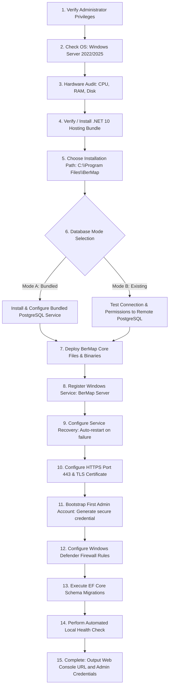
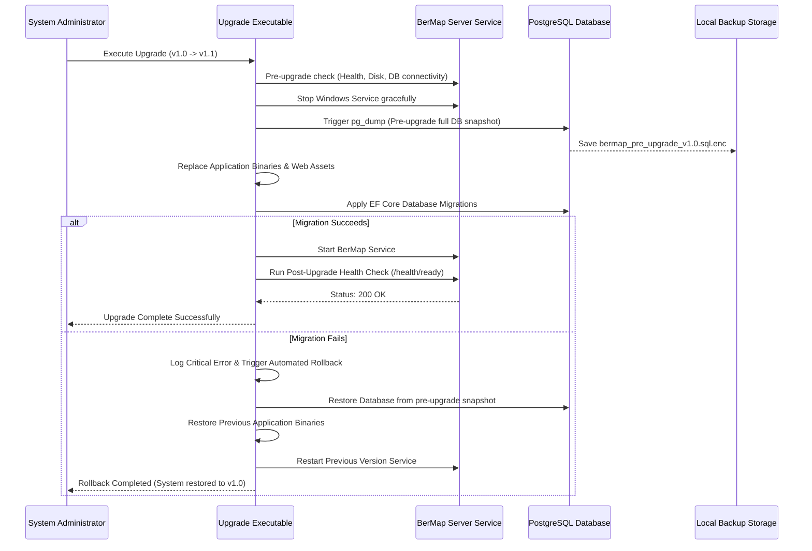

# 13 — Installation, Upgrade & Rollback Architecture

> **BerMap — Enterprise Infrastructure Intelligence & Simulation Platform**  
> *"Discover. Map. Analyze. Simulate. Predict."*

---

## 1. Overview & Constraints

BerMap is engineered for strictly air-gapped, on-premises corporate datacenters. All installation, upgrade, maintenance, and disaster recovery workflows must function completely offline without access to public package repositories, container registries, or remote licensing validation servers.

---

## 2. Windows Server Deployment (Primary Target)

### 2.1 Single Offline Installer (`BerMap-Server-Setup-x64.exe`)
The installer is a self-contained executable packaging:
- .NET 10 Runtime (Windows Server Hosting Bundle)
- BerMap API Server & Static Web Console Assets
- BerMap Background Worker Service
- Bundled PostgreSQL 16 Binaries (Offline distribution)
- EF Core Database Migration Bundle (`bundle.exe`)
- SSL/TLS Self-Signed Certificate Provisioner (with enterprise PKI import option)

### 2.2 15-Step Installer Workflow


### 2.3 Silent & Unattended Installation
For automated enterprise rollouts via Microsoft SCCM / MECM or HCL BigFix:

```powershell
# Mode A: Bundled PostgreSQL Silent Install
BerMap-Server-Setup-x64.exe /quiet /norestart `
  INSTALLDIR="D:\BerMap" `
  DB_MODE="Bundled" `
  DB_PORT=5432 `
  HTTP_PORT=80 `
  HTTPS_PORT=443 `
  ADMIN_EMAIL="secadmin@enterprise.local" `
  ADMIN_PASSWORD="SecureGeneratedPassword123!" `
  LOGFILE="C:\Windows\Temp\bermap_install.log"

# Mode B: Existing PostgreSQL Silent Install
BerMap-Server-Setup-x64.exe /quiet /norestart `
  INSTALLDIR="D:\BerMap" `
  DB_MODE="Existing" `
  DB_HOST="db-cluster.enterprise.local" `
  DB_PORT=5432 `
  DB_NAME="bermap_prod" `
  DB_USER="bermap_app" `
  DB_PASSWORD="DbSecretPassword123!" `
  HTTPS_PORT=443 `
  LOGFILE="C:\Windows\Temp\bermap_install.log"
```

---

## 3. Linux Deployment (Offline Docker Bundle)

For Linux environments, BerMap provides `bermap-linux-offline-v{version}.tar.gz`:
1. **Archive Contents**:
   - `bermap-api:latest.tar` (Pre-saved container image)
   - `postgres:16-alpine.tar` (Pre-saved database container image)
   - `docker-compose.yml` (Configured with local bridge network and persistent volumes)
   - `.env.template`
   - `install.sh`, `upgrade.sh`, `backup.sh`, `rollback.sh`
2. **Installation Execution**:
   ```bash
   tar -xzf bermap-linux-offline-v1.0.0.tar.gz
   cd bermap-linux-offline
   chmod +x *.sh
   ./install.sh --db-password "SecureDbPassword123!" --admin-password "SecureAdminPassword123!"
   ```
3. Containers run as non-root users (`uid 10001:10001`) with explicit capability drops (`cap_drop: - ALL`).

---

## 4. Upgrade & Safe Rollback Procedure


