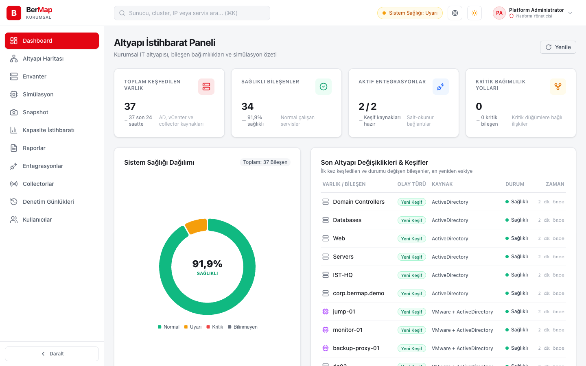

## BerMap 0.3.0 — ilk sunucu sürümü

Kurum içi altyapı keşfi, bağımlılık haritası ve değişiklik simülasyonu. Active Directory ve VMware vCenter salt okunur keşfedilir; bir host, datastore, ağ ya da iş yükü düşerse neyin etkileneceği üretime dokunmadan görülür.

### İndirme
- **BerMap-Server-0.3.0-win-x64.zip** — Windows Server 2019+. Paketi açın, yönetici PowerShell'de `.\Install-BerMapServer.ps1 -DbHost localhost -DbUser bermap`.
- **bermap-server-0.3.0-linux-x64.tar.gz** / **linux-arm64** — systemd kullanan Linux. `sudo ./install.sh --db-host localhost --db-user bermap`.
- **SHA256SUMS.txt** — dosya bütünlüğü (yayıncı doğrulaması değildir).

Paketler self-contained'dir (sunucuda .NET gerekmez) ve web konsolunu içerir. Tek ön koşul PostgreSQL 16+; veritabanı ve şema ilk açılışta kurulur. Kurulum betiği servisi kurar, sunucu hazır olana kadar bekler ve konsol adresini, ilk `admin` parolasını ve collector kayıt token'ını yazar. Aynı betik yükseltme içindir; yapılandırma, kasa ve veritabanı korunur. Ayrıntı: [kurulum rehberi](https://github.com/BerkayAtag/BerMap/blob/main/deploy/KURULUM.md).

Bu paketler yayımlanmadan önce temiz Windows Server ve Ubuntu çalıştırıcılarında kuruldu, giriş yapıldı, yükseltildi ve kaldırıldı.

### Yenilikler
- **Sunucu paketleri ve kurulum betikleri:** Windows servisi (BerMapServer) ve systemd servisi; HTTPS için `.pfx`, güvenlik duvarı kuralı, yükseltme ve kaldırma.
- **Kullanıcılar ve roller:** kullanıcı oluşturma, rol atama, devre dışı bırakma, parola sıfırlama ve kendi parolasını değiştirme. Parola değişince ya da hesap kapanınca eski oturumlar geçersiz olur; son platform yöneticisi korunur.
- **Simülasyon ve etki analizi tek ekranda:** host, datastore, ağ ve yeni **iş yükü kesintisi** senaryoları; senaryo ile hedef türü eşleşmeli. Host arızasında cluster kapasitesi artık **N-1** hesaplanır (düşen host'un kapasitesi çıkarılır) ve yalnız hedefin kendi cluster'ı değerlendirilir.
- **Değişiklik risk raporu:** simülasyon sonucu yazdırılabilir rapor ya da Markdown olarak indirilir.
- **Zamanlanmış keşif:** entegrasyonların cron takvimi çalışır; collector tarafından beslenen entegrasyonlar ayrı işaretlenir ve sunucu tarafında taranmaz.
- **Entegrasyon düzenleme**, collector kaldırma, denetim kaydında filtre/sayfalama/CSV, raporlar sayfasında envanter, denetim ve snapshot dışa aktarımları.
- **Mobil uyumlu konsol:** telefonda menü çekmece olarak açılır.

### Kaldırılanlar
- "Olaylar & Uyarılar" sayfası (panonun kopyasıydı) ve boş `BerMap.Worker` projesi. "Etki Analizi" simülasyon ekranıyla birleşti.

### Önemli düzeltmeler
- Panodaki "son değişiklikler" artık gerçek değişiklikleri gösteriyor (yalnız yeniden görülen düğümleri değil).
- Simülasyon eskimiş bağlantıları (ör. taşınmış VM'in eski host'u) saymıyor; grafik kırpıldığında bunu belirtiyor.
- CSV dışa aktarımları formül enjeksiyonuna karşı korumalı (Türkçe Excel'in `;` ayırıcısı dahil).
- Entegrasyon silindiğinde keşfettiği veriler eskimiş olarak işaretleniyor, işleri ve bekleyen incelemeleri kapanıyor.
- Ayrıntılı liste: [CHANGELOG](https://github.com/BerkayAtag/BerMap/blob/main/CHANGELOG.md).

### Bilinen sınırlar
Paketler kod imzalı değildir. Yalnız Active Directory ve vCenter adaptörleri vardır; collector adaptörleri kendisi çalıştırmaz; simülasyon güncel graf üzerinde çalışır. Konsol girişi yerel hesaplarladır (AD ile giriş, MFA yok). Gerçek AD/vCenter ortamında kabul testi pilot ortamınızda yapılmalıdır.

Tanıtım: https://berkayatag.github.io/BerMap/

© 2026 Berkay Atağ · BerMap
