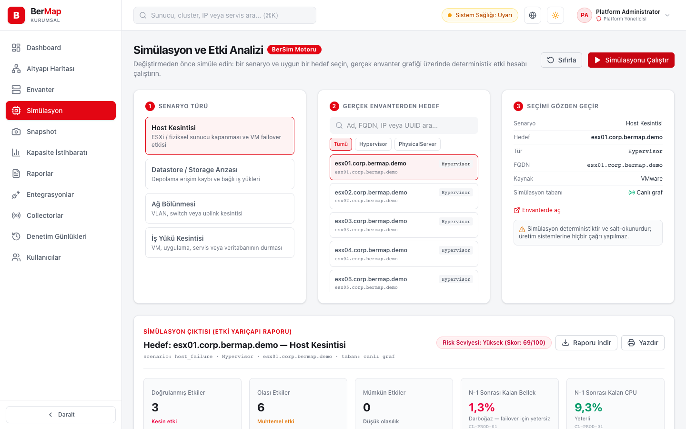

## BerMap 0.4.0 — collector keşfi ve snapshot simülasyonu

Bu sürümle collector, sunucunun erişemediği ağlarda Active Directory ve vCenter keşfini **yerinde ve kendi takvimiyle** yapıyor; simülasyon artık geçmiş bir **snapshot** üzerinde de çalışıyor.

### İndirme
**Sunucu** (API, keşif işçisi, zamanlayıcı, web konsolu):
- **BerMap-Server-0.4.0-win-x64.zip** — Windows Server 2019+: `.\Install-BerMapServer.ps1 -DbHost localhost -DbUser bermap`
- **bermap-server-0.4.0-linux-x64.tar.gz** / **linux-arm64** — systemd: `sudo ./install.sh --db-host localhost --db-user bermap`

**Collector** (şube, DMZ, ayrı forest gibi uzak ağlar için):
- **BerMap-Collector-0.4.0-win-x64.zip**: `.\Install-BerMapCollector.ps1 -ServerUrl https://bermap.corp.local -Name dc2-collector`
- **bermap-collector-0.4.0-linux-x64.tar.gz** / **linux-arm64**: `sudo BERMAP_ENROLLMENT_TOKEN='…' ./install.sh --server-url https://bermap.corp.local --name dc2-collector`

**SHA256SUMS.txt** — tüm dosyaların bütünlüğü (yayıncı doğrulaması değildir).

Paketler self-contained'dir; sunucuda ya da collector makinesinde .NET gerekmez. Sunucunun tek ön koşulu PostgreSQL 16+. Kurulum betikleri yükseltme için de kullanılır; yapılandırma, kasa ve veritabanı korunur. Ayrıntı: [sunucu kurulumu](https://github.com/BerkayAtag/BerMap/blob/main/deploy/KURULUM.md), [collector kurulumu](https://github.com/BerkayAtag/BerMap/blob/main/deploy/KURULUM-COLLECTOR.md).

Paketler yayımlanmadan önce temiz Windows Server ve Ubuntu çalıştırıcılarında kuruldu; collector kurulan sunucuya kaydoldu ve çevrimiçi göründü. Konsolun tüm işlevleri paketlenmiş sunucu üzerinde uçtan uca tarayıcı testlerinden geçti.

### Yenilikler
- **Collector keşfi:** collector, yapılandırmasındaki collector yönetimli entegrasyonlar için AD ve VMware adaptörlerini cron takvimiyle çalıştırır. Sonuçlar boyutu sınırlı parçalarla gönderilir; başarısız çalışmalar sunucuya bildirilir; sunucuya ulaşılamazsa veriler yerel kuyrukta tutulur. Kuyruk kotası ya da yeniden deneme sınırı yüzünden parça kaybolursa snapshot eksik sayılır, envanter yanlışlıkla "eskimiş" işaretlenmez.
- **Collector paketleri ve kurulum betikleri:** Windows servisi (BerMapCollector) ve systemd servisi; kurulum, collector sunucuya kaydolana kadar bekler.
- **Snapshot üzerinde simülasyon:** simülasyon tabanı olarak güncel graf ya da herhangi bir snapshot seçilebilir; risk raporu tabanı belirtir. Snapshot sayfasında "Simüle et" bağlantısı.
- **Uçtan uca test paketi:** `tests/e2e` (Playwright), konsolun tüm işlevlerini gerçek sunucu ve PostgreSQL üzerinde dener; her değişiklikte CI'da paketlenmiş sunucuya karşı çalışır.
- Collector yönetimli entegrasyon kartında, collector yapılandırması için entegrasyon kimliği gösterilir ve kopyalanabilir.

### Önemli düzeltmeler
- **Metrikler yeniden keşifte güncellenmiyordu:** CPU/RAM kullanımı, güç durumu gibi değerler ilk keşifteki halinde kalıyordu; kapasite ekranı ve N-1 hesabı eski verilerle çalışıyordu. Artık her keşif kendi bildirdiği değerleri yeniler; tek kaynaklı düğümlerde ad ve IP değişiklikleri de yansır.
- Bir entegrasyonun sunucu adresi kayıtlı parola yeniden girilmeden değiştirilemez (kayıtlı servis hesabı parolasının başka bir sunucuya gönderilmesi engellendi).
- İki entegrasyonun paylaştığı ilişkiler çok parçalı keşifte hata vermiyor; silinip yeniden oluşturulan entegrasyon eski ilişkileri devralıyor.
- Collector parçası işlenemediğinde entegrasyon "Hata" olarak görünüyor (önceden "Aktif" kalıyordu).
- Snapshot karşılaştırması iç kayıt alanlarını değişiklik saymıyor.
- Windows kurulumları veri dizininin sahipliğini de alıyor; kurulum/kaldırma betikleri başka bir ürünün dizinine dokunmuyor.
- Konsol: iletişim kutularında klavye odağı, AD sihirbazında StartTLS portu, İngilizce arayüzde giriş hata mesajı, kendi rolünü değiştiren yönetici için uyarı.
- Ayrıntılı liste: [CHANGELOG](https://github.com/BerkayAtag/BerMap/blob/main/CHANGELOG.md).

### Yükseltme
Sunucuyu ve collector'ları yeni paketle aynı betiği parametresiz çalıştırarak yükseltin. 0.3.0'dan yükseltmede ek adım gerekmez.

### Bilinen sınırlar
Paketler kod imzalı değildir. Yalnız Active Directory ve vCenter adaptörleri vardır. Konsol girişi yerel hesaplarladır (AD ile giriş, MFA yok). Gerçek AD/vCenter ortamında kabul testi pilot ortamınızda yapılmalıdır.

Tanıtım: https://berkayatag.github.io/BerMap/

© 2026 Berkay Atağ · BerMap
